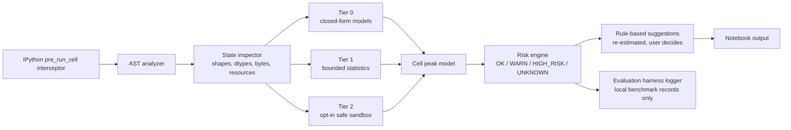

# NEXUS

NEXUS is an IPython extension that predicts peak RAM and wall time **before** a Jupyter cell runs. It combines the cell's
syntax with the live kernel's object shapes, dtypes, sizes, and available resources, then applies tiered operation models
to produce ranges, confidence, risk, and optional rule-based suggestions. Unknown operations stay unestimated rather than
receiving a guess.

## Quick start

From a checkout, install the package:

```bash
pip install -e .
```

In a Jupyter notebook:

```python
%load_ext nexus
%nexus verbose on
```

Then create a frame and run a supported operation:

```python
import pandas as pd

frame = pd.DataFrame({"key": [1, 1, 2], "value": [10, 10, 20]})
frame.drop_duplicates()
```

Before that cell executes, verbose mode displays the detected operation, inspected object details, RAM low/expected/high,
an order-of-magnitude time bucket, confidence, cost drivers, and the risk classification. By default, NEXUS prints only
WARN and HIGH_RISK alerts. Suggestions can be requested with `%nexus suggestions`; they are proposals, are re-estimated,
and are never applied or executed automatically.

## Supported environment

| Requirement | Support |
|---|---|
| Python | Python >= 3.11. Python 3.10 is unsupported. |
| pandas | pandas >= 3.1. Model derivations and the reported evaluations used pandas 3.1.1; other versions have not been independently validated. |
| Operating system | Windows and Linux. macOS peak-memory measurement is unsupported. |
| NumPy | Installed as a dependency; the reference environment used NumPy 2.5.5. |
| IPython | IPython 8 or later. Load NEXUS in an IPython/Jupyter kernel. |

## Supported operations

“Validated” means that the listed form has a passing derivation probe; it does not mean every input shape, dtype, machine,
or workload has been validated. “Partial” means the model deliberately accepts only a scoped subset. The analyzer can
recognize operations that still have no model.

| Operation | Status | Scope / limitation |
|---|---|---|
| `DataFrame.drop_duplicates` | Validated | Estimates depend on key cardinality and nulls; Tier 1 statistics are bounded. |
| `DataFrame.dropna` | Validated | Supported forms are limited to derived arguments and known frames. |
| `Series.dropna` | Validated | Supported forms are limited to derived arguments and known Series. |
| `DataFrame.merge` | Partial | Limited supported arguments and frame state; RAM warning false alarms remain a known risk-engine failure. |
| `pandas.merge` | Partial | Limited supported arguments and frame state; RAM warning false alarms remain a known risk-engine failure. |
| `DataFrame.groupby` | Partial | Cost depends on key cardinality and aggregation; some per-operation ranges miss the calibration target. |
| `DataFrame.sort_values` | Partial | Time-range coverage is below its development target. |
| `pandas.concat` | Partial | Some dtype/category paths are modeled; concatenating the same frame twice is refused. |
| `pandas.read_csv` | Partial | Local files and understood arguments only. pandas can choose a CPU-dependent serial or parallel reader path. |
| `DataFrame.astype` | Partial | Single-column forms; dict and multi-column forms have no estimate. |
| `Series.astype` | Partial | Single-column forms; dict and multi-column forms have no estimate. |
| `DataFrame.copy` | Partial | Supported receiver forms only; `head()` / `tail()` copies and unknown receivers are refused. |
| `Series.copy` | Partial | Supported receiver forms only; unknown receivers are refused. |
| `DataFrame.fillna` | Partial | Supported scalar/dict values and dtypes only; unsupported extension and Arrow-backed cases are refused. |
| `Series.fillna` | Partial | Supported scalar/dict values and dtypes only; unsupported extension and Arrow-backed cases are refused. |
| `DataFrame.set_index` | Partial | One literal numeric key column; text keys, multiple keys, and several options are refused. |
| `Series.apply` | Partial | Only a supported unary NumPy ufunc on a known Series/column; Python functions have no estimate. |
| `DataFrame.apply` | No estimate | Python-function and other forms are unsupported. |
| `numpy.sort` | Partial | A known ndarray; time evidence is limited. |
| `ndarray @ ndarray` | Partial | Known array shapes/dtypes; time remains machine-dependent. |
| `numpy.array` | Partial | Known numeric ndarray input with `copy=True`; literals, unknown iterables, and `copy=False` are refused. |
| `value_counts` | No estimate | Explicitly deferred in frozen v4. |
| `duplicated` | No estimate | The measured dense-key case contradicted the derivation. |
| `map` | No estimate | `Series.map` forms failed the derivation bar. |
| `explode` | No estimate | Explicitly deferred in frozen v4. |
| `sample` | No estimate | Random-index workspace contradicted the proposed derivation. |
| `describe` | No estimate | Numeric workspace contradicted the proposed derivation. |
| `reset_index` | No estimate | The attempt was invalid; the operation remains deferred. |
| `to_numpy` | No estimate | Zero-copy cases did not provide a measurable incremental peak. |
| `to_csv` | No estimate | Explicitly deferred in frozen v4. |
| `join` | No estimate | Explicitly deferred in frozen v4. |
| `get_dummies` | No estimate | Explicitly deferred in frozen v4. |
| `corr` | No estimate | Explicitly deferred in frozen v4. |
| `numpy.zeros` | No estimate | Lazy pages did not produce a measurable incremental peak. |
| `numpy.empty` | No estimate | Lazy pages did not produce a measurable incremental peak. |
| `numpy.linspace` | No estimate | The float32 probe contradicted the single-output-buffer derivation. |
| Other recognized pandas/NumPy operations | No estimate | Detection is not an estimate; unsupported or unknown code is never guessed. |

The v4 evaluation found runtime coverage of **14/75 operation-bearing development cells (18.7%)**, below the preregistered
55% target (**FAILED**). The optimistic static ceiling was 21/75 (28.0%). See [docs/EVALUATION.md](docs/EVALUATION.md)
and the detailed [known limitations](#known-limitations).

## How it works



Tier 0 uses closed-form cost models. Tier 1 adds bounded, read-only statistics from the live kernel and falls back to
Tier 0 when statistics are unavailable or rejected. Tier 2 is opt-in and may dry-run only operations accepted by its
side-effect safety gate. The cell model accounts for retained outputs and statement order. A partial cell is shown as
“at least X” for the covered operations and has no upper bound for the full cell. Time is shown in order-of-magnitude
buckets, not as a falsely precise point value.

The IPython hook has a short analysis budget and is fail-safe: analysis failures must not prevent the user's cell from
running. Suggestions are never applied automatically. The evaluation harness can write local benchmark records; the
extension itself does not write per-cell JSONL records.

## Privacy

Analysis runs in the local kernel; NEXUS does not send cell code, notebook data, or estimates to a server. Tier 1 derives
a deterministic sampling seed from the cell source using SHA-256 in memory. The extension does not persist the raw cell
source or this seed. The separate benchmark harness records hashes and numeric metadata, not notebook code or data
values.

## Known limitations

- **Coverage FAILED:** 14/75 = 18.7% runtime coverage on the Phase 8 development notebooks, below the 55% preregistered
  target. Static matching is only an optimistic ceiling (21/75 = 28.0%), not runtime coverage.
- **Determinism FAILED:** Tier 1 hard-deadline firings exceeded the preregistered limits both under contention and idle.
  At 10M rows, the idle information-only rerun fell back on all 24/24 attempts; Tier 1 commonly falls back to Tier 0 on
  large cells (around and above 3M rows on the reference laptop).
- **Partial cells:** the displayed lower bound covers only estimated operations; no upper bound is available for the
  complete cell.
- **`read_csv` depends on CPU and pandas internals:** a local read can take different serial or parallel paths based on
  the CPU/worker count. `parse_dates` has no estimate.
- **Narrow empirical base:** one Windows laptop and mostly synthetic benchmark inputs. pandas 3.1.1 is the only pandas
  version used for model derivations and reported evaluation.
- **Risk R2 FAILED:** policy-B ranges exceeded the per-operation false-alarm bar for merge (58.8%) and read_csv (78.0%)
  in the Phase 5 re-evaluation. Risk v2 narrows WARN handling for those operations but does not erase the registered
  failure.
- **Suggestions:** `select_columns` is off by default after an over-prediction failure. Suggestions are filtered and
  must be reviewed for semantics; they are not guarantees of savings.
- **Held-out evidence is mixed:** Phase 7 multicell v2 and v3 groups FAILED; Phase 8a real-notebook accuracy was
  INCONCLUSIVE. The fresh Phase 8b notebook batch, val-v5, and test-v2 have no results in this release documentation.

See [docs/EVALUATION.md](docs/EVALUATION.md) for phase-by-phase evidence and [docs/ARCHITECTURE.md](docs/ARCHITECTURE.md)
for implementation details.

## Development

```bash
pip install -e ".[dev]"
pytest
ruff check .
ruff format --check .
```

## License

MIT; see [LICENSE](LICENSE).
