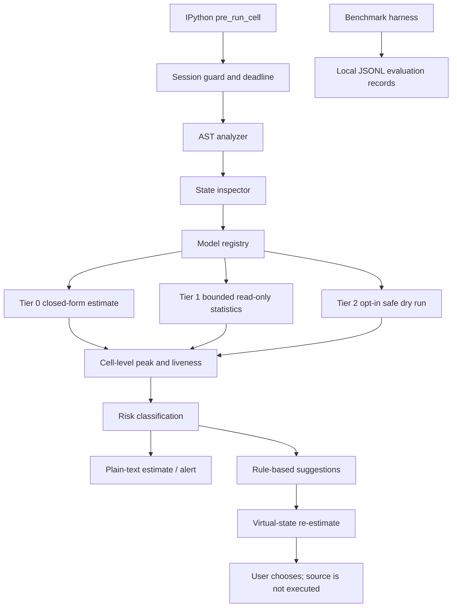

# Architecture

NEXUS analyzes a cell before IPython executes it. Its estimate describes incremental peak RAM and a coarse wall-time
range; it is not a live monitor and does not alter the user's code.

The benchmark harness is separate from the notebook extension: it measures predictions against actuals and may write
local structured records. The extension does not persist cell-level telemetry.

## Runtime path

1. **Interceptor and session** — `nexus.extension` registers IPython `pre_run_cell` and `post_run_cell` hooks.
   `NexusSession` is re-entrant, applies a short analysis deadline, and keeps internal analysis failures from blocking a
   user's cell.
2. **Analyzer** — `nexus.analyzer` parses source with the Python AST, finds known operations in evaluation order, and
   resolves simple aliases. It is syntactic recognition, not proof that a call is supported. Unknown code produces no
   estimate.
3. **State inspector** — `nexus.state` reads descriptors of live DataFrames, Series, arrays, candidate files, available
   RAM, and container limits. It avoids copying complete user objects just to inspect them.
4. **Operation registry** — models implement `matches`, `features`, and `estimate`. A model can refuse a form with
   `NoEstimateError`; the pipeline does not substitute an invented value.
5. **Tiered estimation**:
   - **Tier 0** applies a closed-form cost model to the inspected features.
   - **Tier 1** adds bounded statistics such as null rates, distinct counts, or join-output estimates. Sampling is
     deterministic for the same source/data context, read-only, and deadline-bounded. Rejected or unavailable
     statistics retain Tier 0 where the model supports it.
   - **Tier 2** is opt-in. The controller may run a dry-run only for a cell accepted by the safety analyzer, in a spawned
     process, then fit a scaling relation. It is not a general fallback for unknown or side-effecting code.
6. **Cell peak** — `nexus.cellpeak` considers operation order, retained outputs, temporaries, and safe rebinding. It uses
   a conservative older aggregation for syntax it cannot analyze precisely.
7. **Risk engine** — `nexus.risk` compares the cell range with effective headroom and assigns OK, WARN, HIGH_RISK, or
   UNKNOWN. An uncovered operation prevents a cell from being reported as safely OK. Partial results show a covered-part
   lower bound only.
8. **Suggestions** — rules reason about safe, local source rewrites and virtual states. The estimator re-estimates a
   candidate before showing it; a user must decide whether to use it.

## Measurement and evaluation

The benchmark instrument uses a spawned child and an OS peak counter, with `psutil` polling as a cross-check and
watchdog. Platform-specific peak-memory reads are isolated in `nexus.measure`. Windows peak counters are monotonic, so
measurements below the setup peak can be censored rather than reported as zero. See the [evaluation methodology](EVALUATION.md)
and [instrument validation](benchmarks/phase8a/harness_validation.md).

The frozen model stack is guarded by the [v4 manifest](benchmarks/frozen-manifest.md). A held-out evaluation checks that
frozen files match the tagged hashes before any measurement. Reports distinguish development data from held-out data;
the fresh Phase 8b real-notebook batch, val-v5, and test-v2 have not been read or run for this documentation.
