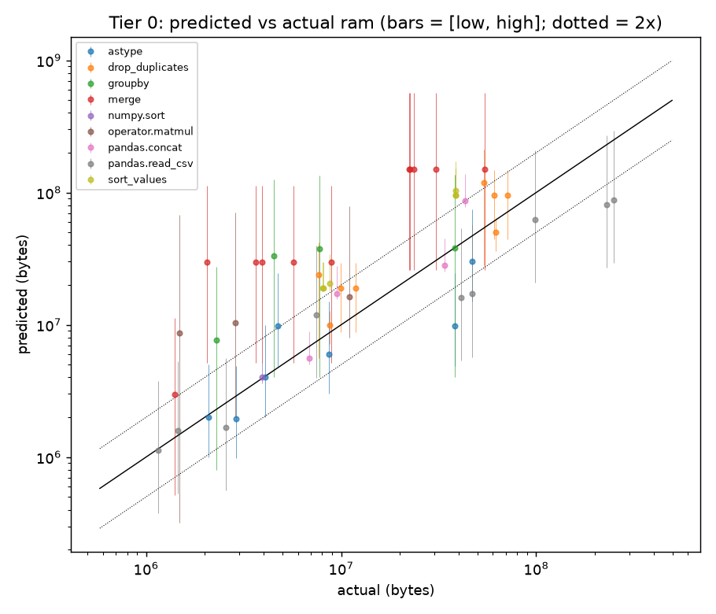
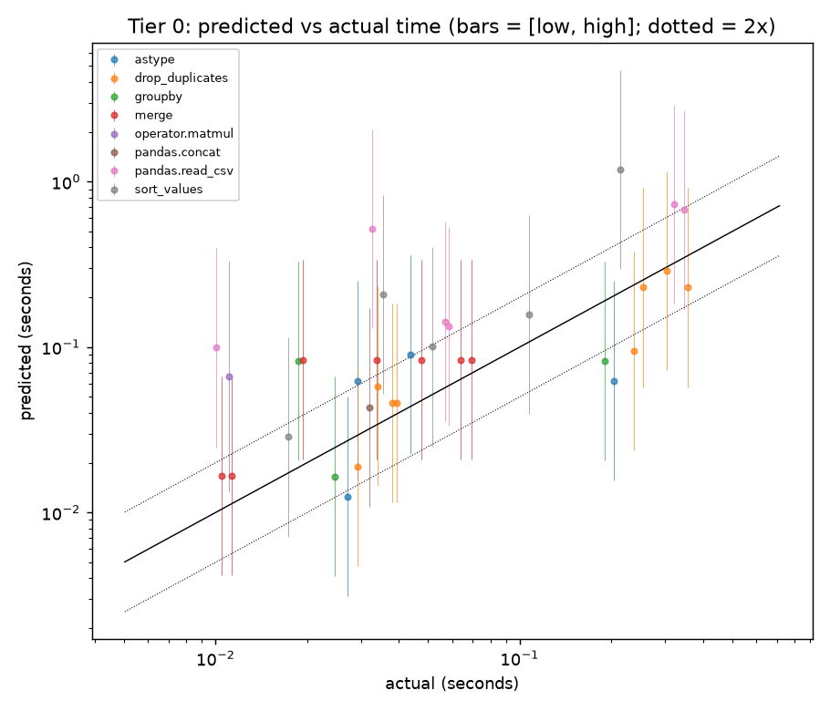
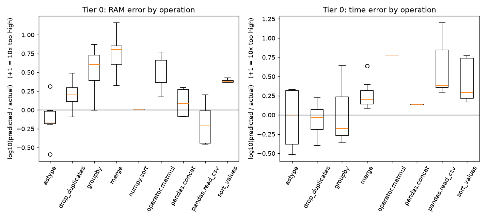
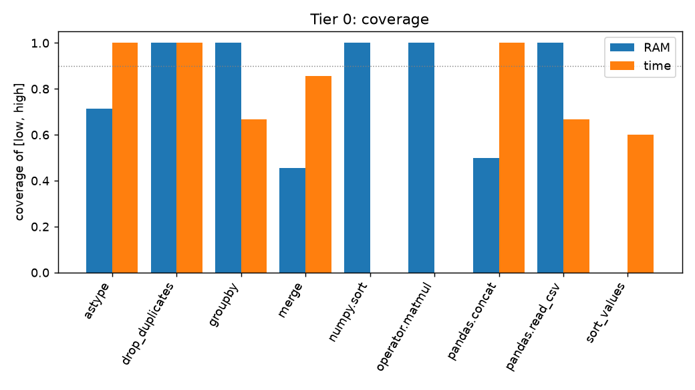

# NEXUS benchmark report: `small`

Platform Windows-11-10.0.26200-SP0, Python 3.12.5, pandas 3.1.1, numpy 2.5.5, 16 logical CPUs, git `6f87884`. Memory cap per child process: 1391 MB.

Grid points by outcome: {'ok': 87}.

Validity filters: RAM points need actual >= 1 MiB, time points need actual >= 10 ms. Percentages below are of valid points.

## Tier 0

### Estimate availability and sample sizes

| op | points | estimated | ram_n | time_n |
|---|---|---|---|---|
| astype | 15 | 15 | 7 | 4 |
| drop_duplicates | 15 | 15 | 8 | 8 |
| groupby | 9 | 9 | 4 | 3 |
| merge | 15 | 15 | 11 | 7 |
| numpy.sort | 6 | 6 | 1 | 0 |
| operator.matmul | 3 | 3 | 3 | 1 |
| pandas.concat | 6 | 6 | 4 | 1 |
| pandas.read_csv | 9 | 9 | 9 | 6 |
| sort_values | 9 | 9 | 6 | 5 |
| ALL | 87 | 87 | 53 | 35 |

### RAM accuracy

| op | ram_n | ram_err_med | ram_err_p90 | ram_bias | ram_cov | ram_above_high | ram_below_low | ram_width |
|---|---|---|---|---|---|---|---|---|
| astype | 7 | 32% | 88% | 0.69 | 71% | 14% | 14% | 200% |
| drop_duplicates | 8 | 59% | 147% | 1.59 | 100% | 0% | 0% | 106% |
| groupby | 4 | 308% | 562% | 4.08 | 100% | 0% | 0% | 352% |
| merge | 11 | 533% | 720% | 6.33 | 45% | 0% | 55% | 359% |
| numpy.sort | 1 | 2% | 2% | 1.02 | 100% | 0% | 0% | 40% |
| operator.matmul | 3 | 261% | 443% | 3.61 | 100% | 0% | 0% | 621% |
| pandas.concat | 4 | 50% | 95% | 1.32 | 50% | 0% | 50% | 70% |
| pandas.read_csv | 9 | 60% | 65% | 0.63 | 100% | 0% | 0% | 300% |
| sort_values | 6 | 140% | 157% | 2.40 | 0% | 0% | 100% | 68% |
| ALL | 53 | 92% | 558% | 1.92 | 70% | 2% | 28% | 243% |

### Time accuracy

| op | time_n | time_err_med | time_err_p90 | time_bias | time_cov | time_above_high | time_below_low | time_width |
|---|---|---|---|---|---|---|---|---|
| astype | 4 | 87% | 111% | 1.26 | 100% | 0% | 0% | 375% |
| drop_duplicates | 8 | 28% | 63% | 0.93 | 100% | 0% | 0% | 375% |
| groupby | 3 | 57% | 285% | 0.67 | 67% | 0% | 33% | 375% |
| merge | 7 | 59% | 222% | 1.59 | 86% | 0% | 14% | 375% |
| numpy.sort | 0 | – | – | – | – | – | – | – |
| operator.matmul | 1 | 501% | 501% | 6.01 | 0% | 0% | 100% | 480% |
| pandas.concat | 1 | 35% | 35% | 1.35 | 100% | 0% | 0% | 375% |
| pandas.read_csv | 6 | 140% | 1187% | 2.40 | 67% | 0% | 33% | 375% |
| sort_values | 5 | 95% | 472% | 1.95 | 60% | 0% | 40% | 375% |
| ALL | 35 | 69% | 472% | 1.65 | 80% | 0% | 20% | 378% |

`above_high` = actual exceeded the predicted high (under-prediction beyond the range); `below_low` = actual fell under the predicted low. bias = median(expected / actual).

### Per case (variant) detail

| case | ram_n | ram_bias | ram_cov | time_n | time_bias | time_cov |
|---|---|---|---|---|---|---|
| astype/float_to_float32 | 1 | 0.96 | 100% | 0 | – | – |
| astype/int_to_float64 | 1 | 0.98 | 100% | 0 | – | – |
| astype/int_to_str | 2 | 0.67 | 100% | 1 | 2.05 | 100% |
| astype/str_to_category_highcard | 2 | 0.47 | 50% | 2 | 0.38 | 100% |
| astype/str_to_category_lowcard | 1 | 2.07 | 0% | 1 | 2.14 | 100% |
| drop_duplicates/mixed_dup0 | 2 | 1.75 | 100% | 2 | 1.05 | 100% |
| drop_duplicates/mixed_dup50 | 2 | 1.47 | 100% | 2 | 0.90 | 100% |
| drop_duplicates/numeric_dup50 | 2 | 0.98 | 100% | 2 | 0.52 | 100% |
| drop_duplicates/strings_dup50 | 2 | 2.65 | 100% | 2 | 1.33 | 100% |
| drop_duplicates/subset_s0_lowcard | 0 | – | – | 0 | – | – |
| groupby/int_sum_numeric | 1 | 7.39 | 100% | 0 | – | – |
| groupby/str_highcard_sum_f0 | 2 | 2.17 | 100% | 2 | 0.55 | 100% |
| groupby/str_lowcard_sum_f0 | 1 | 4.81 | 100% | 1 | 4.42 | 0% |
| merge/inner_1to1 | 2 | 5.78 | 50% | 1 | 1.77 | 100% |
| merge/inner_fanout3 | 2 | 6.56 | 50% | 2 | 1.40 | 100% |
| merge/inner_manymany | 3 | 2.75 | 100% | 2 | 1.39 | 100% |
| merge/inner_overlap10 | 2 | 10.62 | 0% | 1 | 4.33 | 0% |
| merge/left_1to1 | 2 | 7.11 | 0% | 1 | 2.48 | 100% |
| np_sort/random | 1 | 1.02 | 100% | 0 | – | – |
| np_sort/sorted | 0 | – | – | 0 | – | – |
| matmul/square_f64 | 3 | 3.61 | 100% | 1 | 6.01 | 0% |
| concat/mixed | 2 | 1.91 | 0% | 1 | 1.35 | 100% |
| concat/numeric | 2 | 0.82 | 100% | 0 | – | – |
| read_csv/mixed | 3 | 0.36 | 100% | 2 | 2.40 | 100% |
| read_csv/numeric | 3 | 0.98 | 100% | 2 | 12.87 | 0% |
| read_csv/strings | 3 | 0.39 | 100% | 2 | 2.11 | 100% |
| sort_values/by_int | 2 | 2.39 | 0% | 1 | 1.95 | 100% |
| sort_values/by_int_float | 2 | 2.50 | 0% | 2 | 1.56 | 100% |
| sort_values/by_str | 2 | 2.41 | 0% | 2 | 5.69 | 0% |

### OOM warnings (simulated memory limits)

| limit_mb | rule | positives | tp | fp | fn | tn | precision | recall |
|---|---|---|---|---|---|---|---|---|
| 64 | high | 25 | 25 | 11 | 0 | 51 | 69% | 100% |
| 64 | expected | 25 | 25 | 0 | 0 | 62 | 100% | 100% |
| 128 | high | 11 | 10 | 10 | 1 | 66 | 50% | 91% |
| 128 | expected | 11 | 8 | 7 | 3 | 69 | 53% | 73% |
| 256 | high | 0 | 0 | 8 | 0 | 79 | 0% | – |
| 256 | expected | 0 | 0 | 1 | 0 | 86 | 0% | – |
| 512 | high | 0 | 0 | 5 | 0 | 82 | 0% | – |
| 512 | expected | 0 | 0 | 0 | 0 | 87 | – | – |
| 1024 | high | 0 | 0 | 0 | 0 | 87 | – | – |
| 1024 | expected | 0 | 0 | 0 | 0 | 87 | – | – |
| 2048 | high | 0 | 0 | 0 | 0 | 87 | – | – |
| 2048 | expected | 0 | 0 | 0 | 0 | 87 | – | – |
| 4096 | high | 0 | 0 | 0 | 0 | 87 | – | – |
| 4096 | expected | 0 | 0 | 0 | 0 | 87 | – | – |

### Analysis overhead (budget 250 ms)

| op | n | cold_med_ms | cold_p90_ms | warm_med_ms | warm_max_ms | over_budget | analysis_peak_MB_med |
|---|---|---|---|---|---|---|---|
| astype | 15 | 2.92 | 4.16 | 2.38 | 4.01 | 0 | 0.05 |
| drop_duplicates | 15 | 2.89 | 4.76 | 2.49 | 6.34 | 0 | 0.07 |
| groupby | 9 | 2.60 | 4.78 | 2.22 | 4.74 | 0 | 0.08 |
| merge | 15 | 4.53 | 6.13 | 3.89 | 5.33 | 0 | 0.08 |
| numpy.sort | 6 | 0.30 | 0.31 | 0.18 | 0.20 | 0 | 0.07 |
| operator.matmul | 3 | 0.28 | 0.28 | 0.18 | 0.18 | 0 | 0.00 |
| pandas.concat | 6 | 1.74 | 5.75 | 1.47 | 5.51 | 0 | 0.04 |
| pandas.read_csv | 9 | 0.28 | 0.29 | 0.18 | 0.30 | 0 | 0.07 |
| sort_values | 9 | 2.93 | 4.25 | 2.50 | 3.66 | 0 | 0.08 |
| ALL | 87 | 2.62 | 4.98 | 2.29 | 6.34 | 0 | 0.07 |

### Figures

### Ten worst RAM predictions

| point_id | actual_MB | expected_MB | low_MB | high_MB |
|---|---|---|---|---|
| merge/inner_overlap10|n=100000 | 1.96 | 28.40 | 4.90 | 107 |
| merge/inner_fanout3|n=100000 | 3.46 | 28.40 | 4.90 | 107 |
| merge/left_1to1|n=100000 | 3.74 | 28.40 | 4.90 | 107 |
| groupby/int_sum_numeric|n=500000 | 4.31 | 31.85 | 3.81 | 120 |
| merge/inner_overlap10|n=500000 | 21.25 | 143 | 24.60 | 537 |
| merge/left_1to1|n=500000 | 21.54 | 143 | 24.60 | 537 |
| merge/inner_1to1|n=500000 | 22.58 | 143 | 24.60 | 537 |
| matmul/square_f64|n=200 | 1.41 | 8.31 | 0.31 | 64.46 |
| merge/inner_1to1|n=100000 | 5.44 | 28.40 | 4.90 | 107 |
| merge/inner_fanout3|n=500000 | 29.09 | 143 | 24.60 | 537 |

## Points that did not produce a measurement

_no data_

## Measurement caveats

- RAM is *incremental peak RSS* polled every ~2 ms from the parent process. Spikes shorter than
  that can be missed; below 1 MiB the number is allocator/page noise and is excluded.
- RSS counts resident pages only: lazily allocated memory is invisible until touched, and memory
  freed during dataset construction that the allocator kept can be reused by the operation without
  raising RSS (under-measurement). Windows reports working set.
- Time is wall-clock around the single call inside a fresh process (cold caches for first-touch
  data are included; no warm-up). Median of the repeats; the raw repeats are in `actuals.csv`.
- Datasets are synthetic (see `benchmarks/datasets.py`); real-world value distributions, dtype
  mixes and file layouts will differ. Phase 8 covers real data.
- The Tier 0 constants were fixed before any result was seen; nothing has been tuned.
