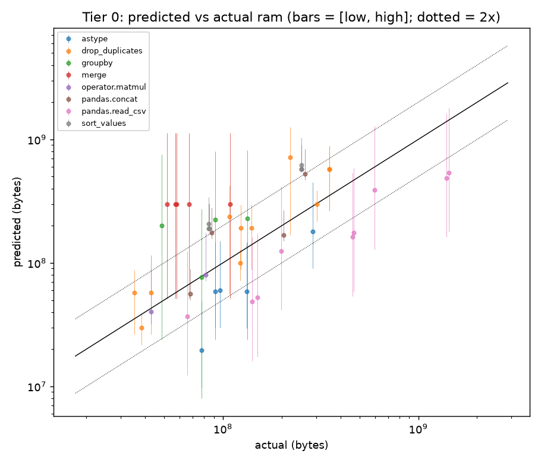
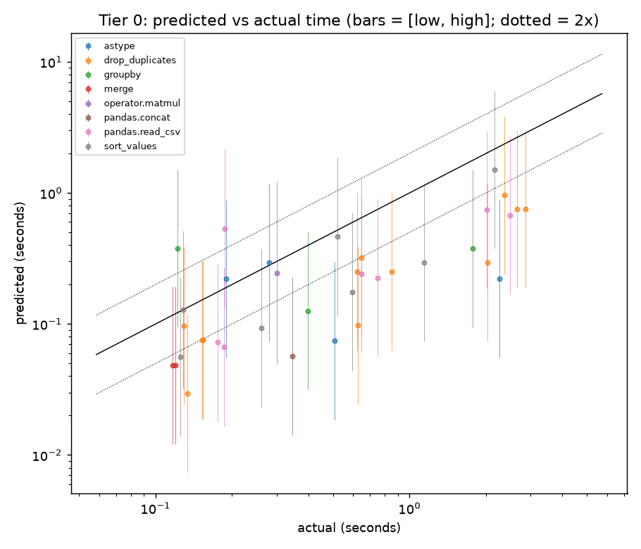
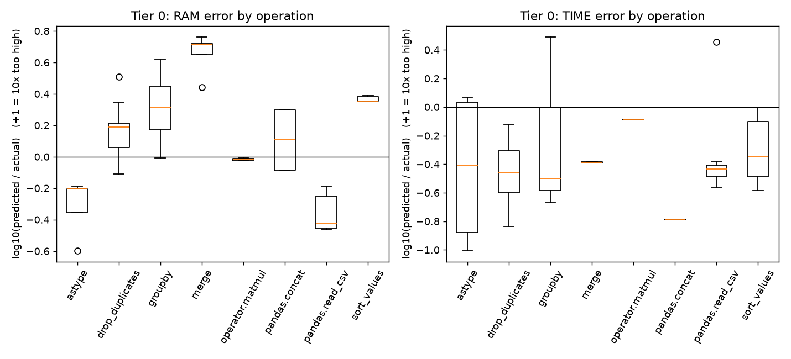
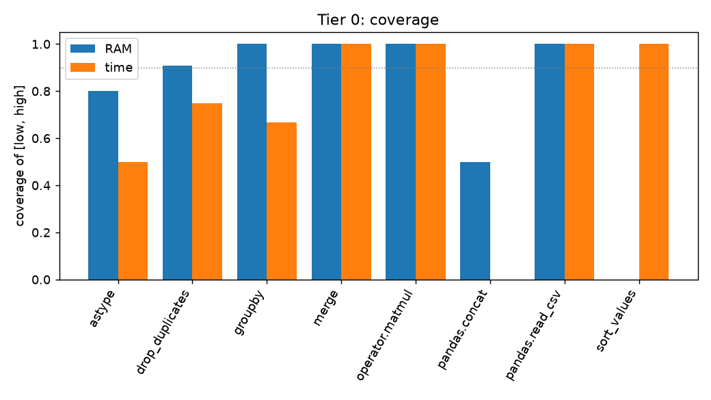

# NEXUS benchmark report: `small`

Instrument `os-peak-v2`. Windows-11-10.0.26200-SP0, Python 3.12.5, pandas 3.1.1 (default string dtype `str`, generated text columns `object`), numpy 2.5.5, pyarrow none, CPU Intel64 Family 6 Model 186 Stepping 2, GenuineIntel (16 logical, max 2400 MHz), git `6154ddb`. Memory cap per child process: 1519 MB. Machine profile calibrated: True.

Grid points by outcome: {'ok': 82, 'skipped_cap': 5}.

Floors: RAM >= 32 MiB above baseline, time >= 100 ms, relative spread <= 30%. Points below a floor are *censored*; points above the spread threshold are *excluded*; accuracy covers *valid* points only.

## Classification of measurements (all points that ran)

| op | points | ram_valid | ram_cens_setup_peak | ram_cens_floor | ram_excluded | time_valid | time_cens_setup_peak | time_cens_floor | time_excluded |
|---|---|---|---|---|---|---|---|---|---|
| astype | 15 | 5 | 0 | 10 | 0 | 4 | 0 | 11 | 0 |
| drop_duplicates | 15 | 11 | 0 | 4 | 0 | 12 | 0 | 3 | 0 |
| groupby | 9 | 4 | 0 | 5 | 0 | 3 | 0 | 6 | 0 |
| merge | 10 | 5 | 0 | 5 | 0 | 2 | 0 | 8 | 0 |
| numpy.sort | 6 | 0 | 0 | 6 | 0 | 0 | 0 | 6 | 0 |
| operator.matmul | 3 | 2 | 0 | 1 | 0 | 1 | 0 | 2 | 0 |
| pandas.concat | 6 | 4 | 0 | 2 | 0 | 1 | 0 | 5 | 0 |
| pandas.read_csv | 9 | 9 | 0 | 0 | 0 | 7 | 0 | 2 | 0 |
| sort_values | 9 | 6 | 0 | 3 | 0 | 7 | 0 | 2 | 0 |
| ALL | 82 | 46 | 0 | 36 | 0 | 37 | 0 | 45 | 0 |

`cens_setup_peak` = operation never exceeded the peak reached while loading inputs; `cens_floor` = measured but below the floor.

## Instrument cross-check (OS peak vs polled RSS)

| op | uncensored_runs | poll_over_os | poll_missed_half | median_poll_ratio |
|---|---|---|---|---|
| astype | 45 | 0 | 0 | 0.99 |
| drop_duplicates | 45 | 0 | 0 | 0.99 |
| groupby | 27 | 0 | 0 | 0.99 |
| merge | 30 | 0 | 0 | 0.94 |
| numpy.sort | 18 | 0 | 0 | – |
| operator.matmul | 9 | 0 | 0 | 1.00 |
| pandas.concat | 18 | 0 | 1 | 0.96 |
| pandas.read_csv | 27 | 0 | 0 | 0.97 |
| sort_values | 27 | 0 | 0 | 0.97 |
| ALL | 246 | 0 | 1 | 0.98 |

`poll_over_os` should be 0 (polling can only under-measure). `poll_missed_half` = runs where polling saw less than half of the OS peak.

## Tier 0

### Estimate availability and sample sizes

| op | points | estimated | ram_valid | ram_censored | ram_excluded | time_valid | time_censored | time_excluded |
|---|---|---|---|---|---|---|---|---|
| astype | 15 | 15 | 5 | 10 | 0 | 4 | 11 | 0 |
| drop_duplicates | 15 | 15 | 11 | 4 | 0 | 12 | 3 | 0 |
| groupby | 9 | 9 | 4 | 5 | 0 | 3 | 6 | 0 |
| merge | 10 | 10 | 5 | 5 | 0 | 2 | 8 | 0 |
| numpy.sort | 6 | 6 | 0 | 6 | 0 | 0 | 6 | 0 |
| operator.matmul | 3 | 3 | 2 | 1 | 0 | 1 | 2 | 0 |
| pandas.concat | 6 | 6 | 4 | 2 | 0 | 1 | 5 | 0 |
| pandas.read_csv | 9 | 9 | 9 | 0 | 0 | 7 | 2 | 0 |
| sort_values | 9 | 9 | 6 | 3 | 0 | 7 | 2 | 0 |
| ALL | 82 | 82 | 46 | 36 | 0 | 37 | 45 | 0 |

### RAM accuracy (valid points)

| op | ram_n | ram_err_med | ram_err_p90 | ram_bias | ram_cov | ram_above_high | ram_below_low | ram_width |
|---|---|---|---|---|---|---|---|---|
| astype | 5.00 | 38% | 67% | 0.62 | 80% | 20% | 0% | 200% |
| drop_duplicates | 11.00 | 55% | 120% | 1.55 | 91% | 9% | 0% | 102% |
| groupby | 4.00 | 109% | 263% | 2.09 | 100% | 0% | 0% | 352% |
| merge | 5.00 | 416% | 458% | 5.16 | 100% | 0% | 0% | 359% |
| numpy.sort | – | – | – | – | – | – | – | – |
| operator.matmul | 2.00 | 4% | 5% | 0.96 | 100% | 0% | 0% | 167% |
| pandas.concat | 4.00 | 59% | 99% | 1.41 | 50% | 0% | 50% | 70% |
| pandas.read_csv | 9.00 | 63% | 65% | 0.37 | 100% | 0% | 0% | 300% |
| sort_values | 6.00 | 127% | 146% | 2.27 | 0% | 0% | 100% | 67% |
| ALL | 46.00 | 64% | 268% | 1.35 | 78% | 4% | 17% | 197% |

### Time accuracy (valid points)

| op | time_n | time_err_med | time_err_p90 | time_bias | time_cov | time_above_high | time_below_low | time_width |
|---|---|---|---|---|---|---|---|---|
| astype | 4.00 | 52% | 89% | 0.60 | 50% | 50% | 0% | 375% |
| drop_duplicates | 12.00 | 65% | 84% | 0.35 | 75% | 25% | 0% | 375% |
| groupby | 3.00 | 79% | 184% | 0.32 | 67% | 33% | 0% | 375% |
| merge | 2.00 | 59% | 59% | 0.41 | 100% | 0% | 0% | 375% |
| numpy.sort | – | – | – | – | – | – | – | – |
| operator.matmul | 1.00 | 19% | 19% | 0.81 | 100% | 0% | 0% | 480% |
| pandas.concat | 1.00 | 84% | 84% | 0.16 | 0% | 100% | 0% | 375% |
| pandas.read_csv | 7.00 | 64% | 118% | 0.37 | 100% | 0% | 0% | 375% |
| sort_values | 7.00 | 55% | 72% | 0.45 | 100% | 0% | 0% | 375% |
| ALL | 37.00 | 64% | 85% | 0.38 | 81% | 19% | 0% | 378% |

`above_high` = actual exceeded the predicted high (under-prediction beyond the range); `below_low` = actual fell under the predicted low. bias = median(expected / actual).

### Per case (variant) detail

| case | ram_n | ram_bias | ram_cov | time_n | time_bias | time_cov |
|---|---|---|---|---|---|---|
| astype/float_to_float32 | – | – | – | – | – | – |
| astype/int_to_float64 | – | – | – | – | – | – |
| astype/int_to_str | 2.00 | 0.62 | 100% | 1.00 | 1.05 | 100% |
| astype/str_to_category_highcard | 2.00 | 0.35 | 50% | 2.00 | 0.12 | 0% |
| astype/str_to_category_lowcard | 1.00 | 0.64 | 100% | 1.00 | 1.18 | 100% |
| drop_duplicates/mixed_dup0 | 3.00 | 1.62 | 100% | 3.00 | 0.40 | 100% |
| drop_duplicates/mixed_dup50 | 3.00 | 1.37 | 100% | 3.00 | 0.30 | 100% |
| drop_duplicates/numeric_dup50 | 3.00 | 0.82 | 67% | 3.00 | 0.16 | 0% |
| drop_duplicates/strings_dup50 | 2.00 | 2.71 | 100% | 3.00 | 0.50 | 100% |
| drop_duplicates/subset_s0_lowcard | – | – | – | – | – | – |
| groupby/int_sum_numeric | 1.00 | 4.13 | 100% | – | – | – |
| groupby/str_highcard_sum_f0 | 2.00 | 1.35 | 100% | 2.00 | 0.27 | 50% |
| groupby/str_lowcard_sum_f0 | 1.00 | 2.46 | 100% | 1.00 | 3.11 | 100% |
| merge/inner_1to1 | 1.00 | 5.16 | 100% | – | – | – |
| merge/inner_fanout3 | 1.00 | 4.48 | 100% | 1.00 | 0.42 | 100% |
| merge/inner_manymany | 1.00 | 2.76 | 100% | 1.00 | 0.40 | 100% |
| merge/inner_overlap10 | 1.00 | 5.80 | 100% | – | – | – |
| merge/left_1to1 | 1.00 | 5.26 | 100% | – | – | – |
| np_sort/random | – | – | – | – | – | – |
| np_sort/sorted | – | – | – | – | – | – |
| matmul/square_f64 | 2.00 | 0.96 | 100% | 1.00 | 0.81 | 100% |
| concat/mixed | 2.00 | 1.99 | 0% | 1.00 | 0.16 | 0% |
| concat/numeric | 2.00 | 0.82 | 100% | – | – | – |
| read_csv/mixed | 3.00 | 0.37 | 100% | 3.00 | 0.38 | 100% |
| read_csv/numeric | 3.00 | 0.63 | 100% | 1.00 | 2.86 | 100% |
| read_csv/strings | 3.00 | 0.35 | 100% | 3.00 | 0.30 | 100% |
| sort_values/by_int | 2.00 | 2.26 | 0% | 2.00 | 0.37 | 100% |
| sort_values/by_int_float | 2.00 | 2.46 | 0% | 2.00 | 0.31 | 100% |
| sort_values/by_str | 2.00 | 2.25 | 0% | 3.00 | 0.90 | 100% |

### OOM warnings (simulated memory limits)

| limit_mb | rule | positives | tp | fp | fn | tn | precision | recall |
|---|---|---|---|---|---|---|---|---|
| 64 | high | 66 | 66 | 5 | 0 | 11 | 93% | 100% |
| 64 | expected | 66 | 65 | 3 | 1 | 13 | 96% | 98% |
| 128 | high | 49 | 49 | 16 | 0 | 17 | 75% | 100% |
| 128 | expected | 49 | 47 | 6 | 2 | 27 | 89% | 96% |
| 256 | high | 34 | 33 | 14 | 1 | 34 | 70% | 97% |
| 256 | expected | 34 | 31 | 5 | 3 | 43 | 86% | 91% |
| 512 | high | 19 | 19 | 9 | 0 | 54 | 68% | 100% |
| 512 | expected | 19 | 18 | 1 | 1 | 62 | 95% | 95% |
| 1024 | high | 3 | 3 | 16 | 0 | 63 | 16% | 100% |
| 1024 | expected | 3 | 1 | 5 | 2 | 74 | 17% | 33% |
| 2048 | high | 0 | 0 | 2 | 0 | 80 | 0% | – |
| 2048 | expected | 0 | 0 | 0 | 0 | 82 | – | – |
| 4096 | high | 0 | 0 | 0 | 0 | 82 | – | – |
| 4096 | expected | 0 | 0 | 0 | 0 | 82 | – | – |

### Analysis overhead (budget 250 ms)

| op | n | cold_med_ms | cold_p90_ms | warm_med_ms | warm_max_ms | over_budget |
|---|---|---|---|---|---|---|
| astype | 15 | 4.31 | 5.10 | 3.82 | 6.36 | 0 |
| drop_duplicates | 15 | 4.13 | 7.18 | 3.51 | 8.32 | 0 |
| groupby | 9 | 3.09 | 5.00 | 2.63 | 5.09 | 0 |
| merge | 10 | 5.63 | 6.60 | 4.49 | 5.15 | 0 |
| numpy.sort | 6 | 0.48 | 0.58 | 0.20 | 0.40 | 0 |
| operator.matmul | 3 | 0.45 | 0.67 | 0.19 | 0.42 | 0 |
| pandas.concat | 6 | 4.89 | 11.19 | 3.21 | 14.86 | 0 |
| pandas.read_csv | 9 | 0.45 | 0.53 | 0.20 | 0.24 | 0 |
| sort_values | 9 | 4.71 | 5.91 | 3.58 | 4.86 | 0 |
| ALL | 82 | 4.15 | 6.04 | 3.26 | 14.86 | 0 |

### Figures

### Ten worst RAM predictions (valid points)

| point_id | actual_MB | expected_MB | low_MB | high_MB |
|---|---|---|---|---|
| merge/inner_overlap10|n=1000000 | 49.33 | 286 | 49.19 | 1075 |
| merge/left_1to1|n=1000000 | 54.39 | 286 | 49.19 | 1075 |
| merge/inner_1to1|n=1000000 | 55.39 | 286 | 49.19 | 1075 |
| merge/inner_fanout3|n=1000000 | 63.89 | 286 | 49.19 | 1075 |
| groupby/int_sum_numeric|n=3000000 | 46.24 | 191 | 22.89 | 721 |
| astype/str_to_category_highcard|n=1000000 | 74.30 | 18.69 | 9.35 | 46.73 |
| drop_duplicates/strings_dup50|n=3000000 | 211 | 681 | 160 | 1202 |
| read_csv/strings|n=300000 | 135 | 46.19 | 15.40 | 154 |
| read_csv/mixed|n=300000 | 143 | 49.97 | 16.66 | 167 |
| read_csv/strings|n=3000000 | 1327 | 466 | 155 | 1554 |

## Points that did not produce a measurement

| point_id | status | error |
|---|---|---|
| merge/inner_1to1|n=3000000 | skipped_cap | estimated footprint 1640250000 B > cap |
| merge/inner_overlap10|n=3000000 | skipped_cap | estimated footprint 1640250000 B > cap |
| merge/inner_fanout3|n=3000000 | skipped_cap | estimated footprint 1640250000 B > cap |
| merge/inner_manymany|n=3000000 | skipped_cap | estimated footprint 1640250000 B > cap |
| merge/left_1to1|n=3000000 | skipped_cap | estimated footprint 1640250000 B > cap |

## Measurement caveats

- RAM is *incremental peak resident memory* from the OS peak counter (Windows peak working set,
  Linux VmHWM, macOS ru_maxrss), read inside the measured process before and after the operation.
  On Windows/macOS the counter cannot be reset, so an operation whose peak stays below the peak
  reached while *loading* its inputs is **censored** (reported with an upper bound), not zero.
- RSS counts resident pages only: lazily allocated memory is invisible until touched. Windows
  reports the working set.
- Time is wall-clock around the single call inside a fresh process (no warm-up; first-touch
  effects of freshly loaded data are included). Median of the repeats; raw repeats are in
  `actuals.csv`.
- Polled RSS from the parent is a cross-check only (see the instrument cross-check table).
- Datasets are synthetic (see `benchmarks/datasets.py`); real-world value distributions, dtype
  mixes and file layouts will differ. Phase 8 covers real data.
- Tier 0 RAM models and priors were fixed before any result was seen; the hardware throughputs
  come from the per-machine calibration (`nexus-calibrate-machine`), measured on dedicated
  microbenchmarks. Nothing has been tuned against benchmark results.
