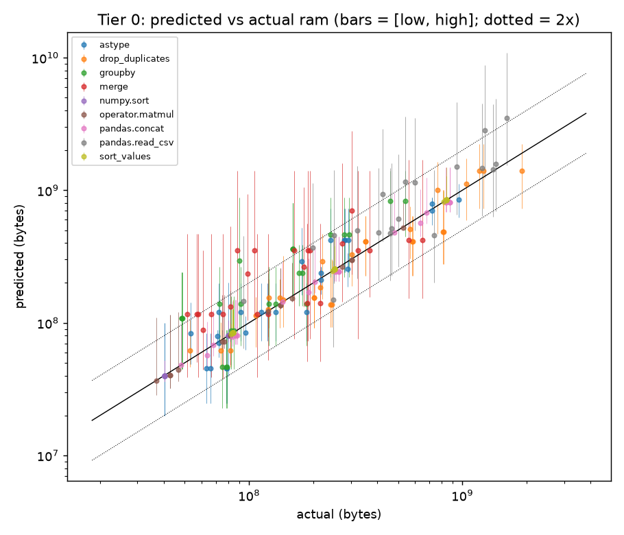
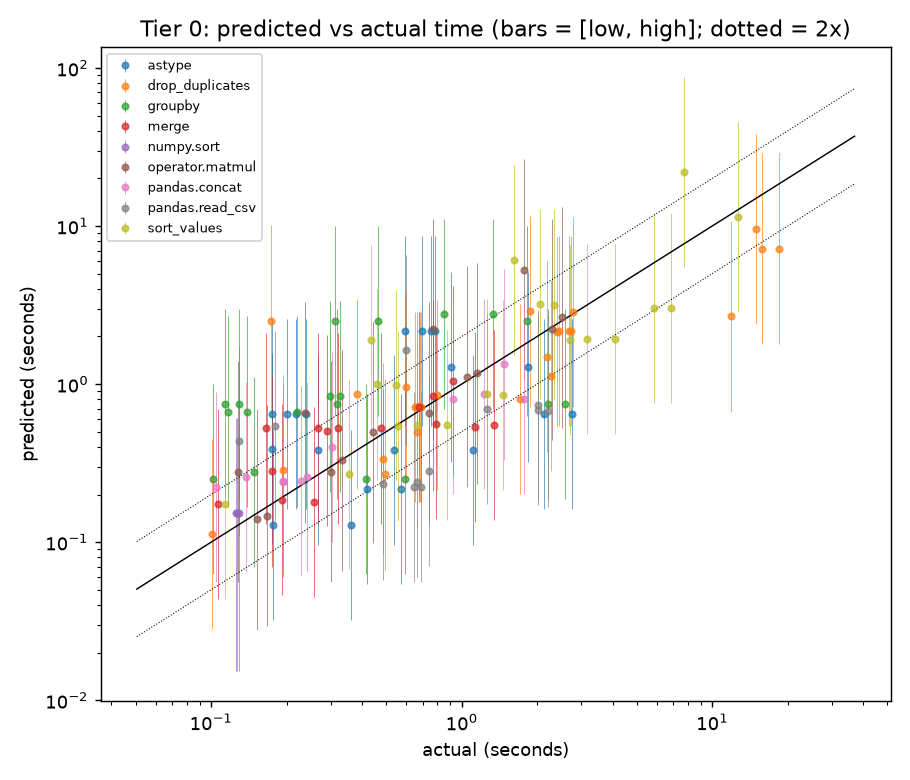
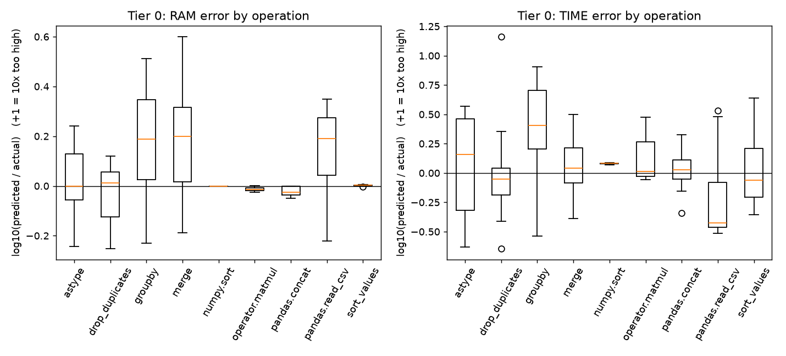
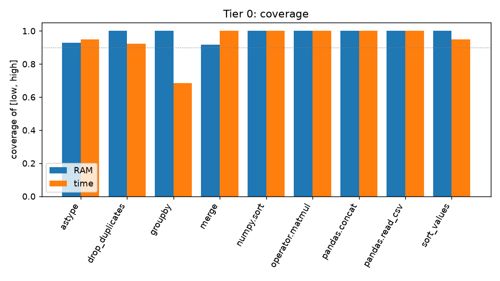
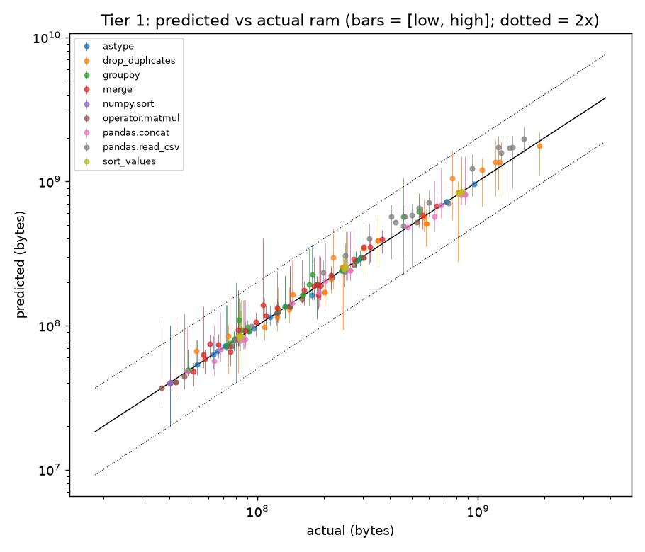
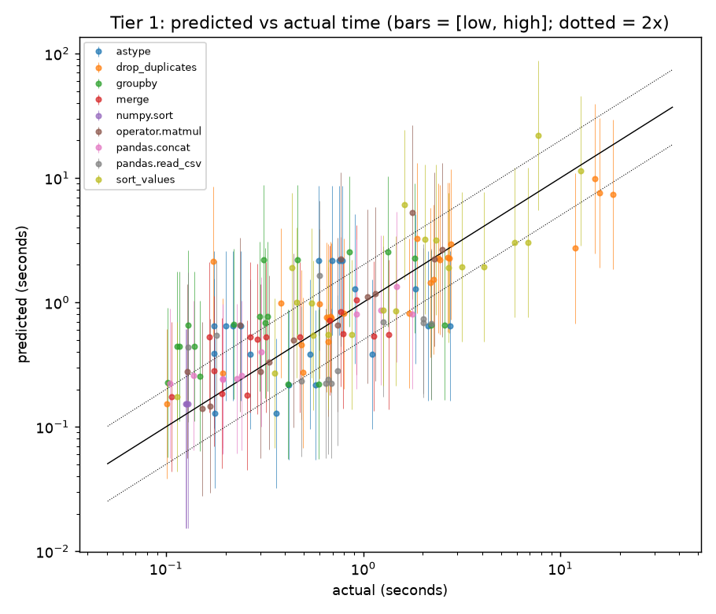
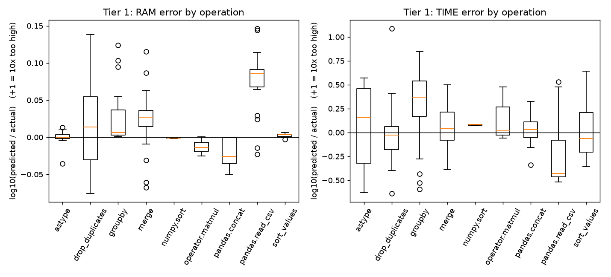
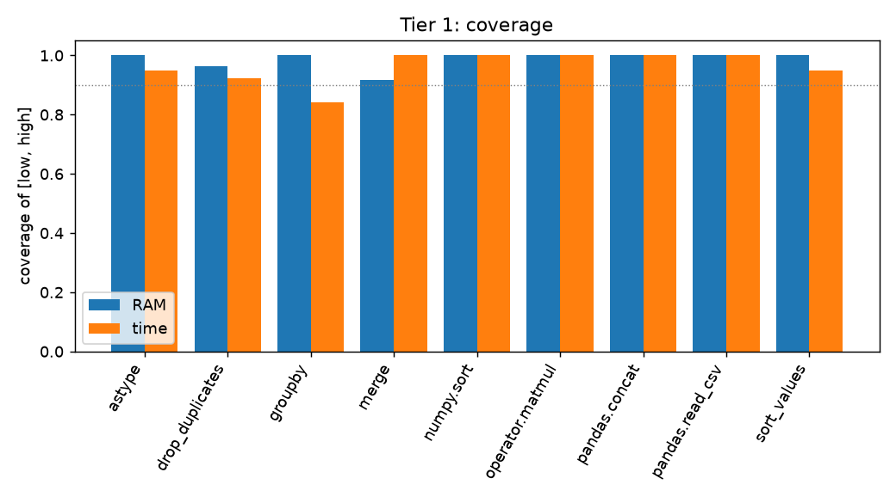

# NEXUS benchmark report (development): `full`

Instrument `os-peak-v2`. Windows-11-10.0.26200-SP0, Python 3.12.5, pandas 3.1.1 (default string dtype `str`, generated text columns `object`), numpy 2.5.5, pyarrow none, CPU Intel64 Family 6 Model 186 Stepping 2, GenuineIntel (16 logical, max 2400 MHz), git `0d5aedc`. Memory cap per child process: 2560 MB. Machine profile calibrated: True.

Floors: RAM >= 32 MiB above baseline, time >= 100 ms, relative spread <= 30%. Points below a floor are *censored*; points above the spread threshold are *excluded*; accuracy covers *valid* points only.

## Dev split

Grid points by outcome: {'ok': 218, 'skipped_cap': 22, 'memory_limit': 1}.

### Classification of measurements (all points that ran)

| op | points | ram_valid | ram_cens_setup_peak | ram_cens_floor | ram_excluded | time_valid | time_cens_setup_peak | time_cens_floor | time_excluded |
|---|---|---|---|---|---|---|---|---|---|
| astype | 40 | 28 | 3 | 9 | 0 | 20 | 0 | 19 | 1 |
| drop_duplicates | 29 | 26 | 1 | 2 | 0 | 26 | 0 | 2 | 1 |
| groupby | 31 | 24 | 0 | 7 | 0 | 19 | 0 | 11 | 1 |
| merge | 24 | 24 | 0 | 0 | 0 | 15 | 0 | 4 | 5 |
| numpy.sort | 12 | 9 | 0 | 3 | 0 | 3 | 0 | 9 | 0 |
| operator.matmul | 19 | 16 | 0 | 3 | 0 | 14 | 0 | 4 | 1 |
| pandas.concat | 21 | 21 | 0 | 0 | 0 | 11 | 0 | 9 | 1 |
| pandas.read_csv | 19 | 19 | 0 | 0 | 0 | 12 | 0 | 4 | 3 |
| sort_values | 23 | 23 | 0 | 0 | 0 | 20 | 0 | 0 | 3 |
| ALL | 218 | 190 | 4 | 24 | 0 | 140 | 0 | 62 | 16 |

`cens_setup_peak` = operation never exceeded the peak reached while loading inputs; `cens_floor` = measured but below the floor.

### Instrument cross-check (OS peak vs polled RSS)

| op | uncensored_runs | poll_over_os | poll_missed_half | median_poll_ratio |
|---|---|---|---|---|
| astype | 111 | 0 | 4 | 0.99 |
| drop_duplicates | 84 | 0 | 0 | 0.99 |
| groupby | 93 | 0 | 0 | 0.97 |
| merge | 72 | 0 | 0 | 0.96 |
| numpy.sort | 36 | 0 | 1 | 1.00 |
| operator.matmul | 57 | 0 | 0 | 1.00 |
| pandas.concat | 63 | 0 | 5 | 0.95 |
| pandas.read_csv | 57 | 0 | 0 | 0.99 |
| sort_values | 69 | 0 | 0 | 0.98 |
| ALL | 642 | 0 | 10 | 0.99 |

`poll_over_os` should be 0 (polling can only under-measure). `poll_missed_half` = runs where polling saw less than half of the OS peak.

### Tier 0

#### Estimate availability and sample sizes

| op | points | estimated | ram_valid | ram_censored | ram_excluded | time_valid | time_censored | time_excluded |
|---|---|---|---|---|---|---|---|---|
| astype | 40 | 40 | 28 | 12 | 0 | 20 | 19 | 1 |
| drop_duplicates | 30 | 30 | 27 | 3 | 0 | 26 | 2 | 1 |
| groupby | 31 | 31 | 24 | 7 | 0 | 19 | 11 | 1 |
| merge | 24 | 24 | 24 | 0 | 0 | 15 | 4 | 5 |
| numpy.sort | 12 | 12 | 9 | 3 | 0 | 3 | 9 | 0 |
| operator.matmul | 19 | 19 | 16 | 3 | 0 | 14 | 4 | 1 |
| pandas.concat | 21 | 21 | 21 | 0 | 0 | 11 | 9 | 1 |
| pandas.read_csv | 19 | 19 | 19 | 0 | 0 | 12 | 4 | 3 |
| sort_values | 23 | 23 | 23 | 0 | 0 | 20 | 0 | 3 |
| ALL | 219 | 219 | 191 | 28 | 0 | 140 | 62 | 16 |

#### RAM accuracy (valid points)

| op | ram_n | ram_err_med | ram_err_p90 | ram_bias | ram_cov | ram_above_high | ram_below_low | ram_width |
|---|---|---|---|---|---|---|---|---|
| astype | 28 | 12% | 59% | 1.00 | 93% | 0% | 7% | 101% |
| drop_duplicates | 27 | 17% | 41% | 1.03 | 100% | 0% | 0% | 104% |
| groupby | 24 | 55% | 125% | 1.55 | 100% | 0% | 0% | 150% |
| merge | 24 | 59% | 135% | 1.59 | 92% | 0% | 8% | 365% |
| numpy.sort | 9 | 0% | 0% | 1.00 | 100% | 0% | 0% | 40% |
| operator.matmul | 16 | 3% | 6% | 0.97 | 100% | 0% | 0% | 126% |
| pandas.concat | 21 | 6% | 10% | 0.94 | 100% | 0% | 0% | 100% |
| pandas.read_csv | 19 | 55% | 118% | 1.55 | 100% | 0% | 0% | 265% |
| sort_values | 23 | 1% | 1% | 1.01 | 100% | 0% | 0% | 47% |
| ALL | 191 | 11% | 92% | 1.01 | 98% | 0% | 2% | 150% |

#### Time accuracy (valid points)

| op | time_n | time_err_med | time_err_p90 | time_bias | time_cov | time_above_high | time_below_low | time_width |
|---|---|---|---|---|---|---|---|---|
| astype | 20 | 73% | 228% | 1.43 | 95% | 5% | 0% | 375% |
| drop_duplicates | 26 | 31% | 69% | 0.89 | 92% | 4% | 4% | 375% |
| groupby | 19 | 155% | 498% | 2.55 | 68% | 0% | 32% | 375% |
| merge | 15 | 53% | 88% | 1.10 | 100% | 0% | 0% | 375% |
| numpy.sort | 3 | 21% | 22% | 1.21 | 100% | 0% | 0% | 390% |
| operator.matmul | 14 | 10% | 186% | 1.04 | 100% | 0% | 0% | 480% |
| pandas.concat | 11 | 26% | 88% | 1.07 | 100% | 0% | 0% | 375% |
| pandas.read_csv | 12 | 66% | 198% | 0.37 | 100% | 0% | 0% | 375% |
| sort_values | 20 | 45% | 194% | 0.86 | 95% | 0% | 5% | 375% |
| ALL | 140 | 53% | 217% | 1.06 | 93% | 1% | 6% | 386% |

`above_high` = actual exceeded the predicted high (under-prediction beyond the range); `below_low` = actual fell under the predicted low. bias = median(expected / actual).

#### Time as an order-of-magnitude bucket (what the user is shown)

| op | time_n | same | within_one | range_hit | repeat_spread_med | repeat_spread_p90 |
|---|---|---|---|---|---|---|
| astype | 20 | 0.60 | 1.00 | 1.00 | 0.04 | 0.16 |
| drop_duplicates | 26 | 0.77 | 1.00 | 1.00 | 0.08 | 0.21 |
| groupby | 19 | 0.74 | 1.00 | 1.00 | 0.08 | 0.18 |
| merge | 15 | 0.80 | 1.00 | 1.00 | 0.11 | 0.13 |
| numpy.sort | 3 | 1.00 | 1.00 | 1.00 | 0.09 | 0.10 |
| operator.matmul | 14 | 0.93 | 1.00 | 1.00 | 0.08 | 0.19 |
| pandas.concat | 11 | 0.82 | 1.00 | 1.00 | 0.11 | 0.15 |
| pandas.read_csv | 12 | 0.58 | 1.00 | 1.00 | 0.10 | 0.22 |
| sort_values | 20 | 0.80 | 1.00 | 1.00 | 0.08 | 0.15 |
| ALL | 140 | 0.76 | 1.00 | 1.00 | 0.08 | 0.19 |

Buckets: under 0.1 s, 0.1-1 s, 1-10 s, 10-60 s, 1-10 min, over 10 min. `same` / `within_one` compare the expected bucket with the measured one; `range_hit` = measured bucket inside the buckets of low..high; `repeat_spread_*` = run-to-run noise of the measurement. The time models stay first drafts (Phase 6 inputs: read_csv under-predicted, groupby / astype / float32 matmul over-predicted).

#### Per case (configuration) detail

| case | ram_n | ram_bias | ram_cov | time_n | time_bias | time_cov |
|---|---|---|---|---|---|---|
| astype/datetime_to_str | 3.00 | 1.10 | 100% | 3.00 | 0.71 | 100% |
| astype/float_to_float32 | 1.00 | 1.00 | 100% | – | – | – |
| astype/int_to_float64 | 1.00 | 1.00 | 100% | – | – | – |
| astype/int_to_int32 | 1.00 | 1.00 | 100% | – | – | – |
| astype/int_to_str | 3.00 | 0.88 | 100% | 2.00 | 1.43 | 100% |
| astype/str_to_category_highcard | 2.00 | 0.74 | 100% | 2.00 | 0.41 | 100% |
| astype/str_to_category_lowcard | 2.00 | 1.41 | 100% | 2.00 | 3.18 | 100% |
| astype/str_to_category_zipf | 3.00 | 0.99 | 100% | 2.00 | 2.92 | 100% |
| v3/astype/float_to_str | 3.00 | 0.97 | 100% | 2.00 | 0.35 | 100% |
| v3/astype/int_to_category_card0p04 | 2.00 | 1.61 | 100% | 1.00 | 2.20 | 100% |
| v3/astype/int_to_int16 | – | – | – | – | – | – |
| v3/astype/str_to_category_card0p75 | 2.00 | 0.61 | 100% | 2.00 | 0.31 | 50% |
| v3/astype/str_to_category_card12000 | 3.00 | 1.05 | 100% | 2.00 | 2.75 | 100% |
| v3/astype/str_to_category_card25 | 2.00 | 1.70 | 0% | 2.00 | 3.68 | 100% |
| drop_duplicates/mixed_dup0 | 3.00 | 1.17 | 100% | 3.00 | 0.79 | 100% |
| drop_duplicates/mixed_dup50 | 3.00 | 1.17 | 100% | 3.00 | 0.88 | 100% |
| drop_duplicates/numeric_dup50 | 3.00 | 1.08 | 100% | 3.00 | 0.47 | 67% |
| drop_duplicates/realistic_nulls_dup30 | 2.00 | 0.73 | 100% | 2.00 | 0.93 | 100% |
| drop_duplicates/strings_dup50 | 3.00 | 1.32 | 100% | 3.00 | 1.03 | 100% |
| drop_duplicates/subset_i0_s0_lowcard | 3.00 | 0.59 | 100% | 2.00 | 1.90 | 100% |
| drop_duplicates/subset_s0_lowcard | – | – | – | 1.00 | 14.57 | 0% |
| v3/drop_duplicates/high_survivor_subset_i0_d0 | 3.00 | 0.60 | 100% | 3.00 | 0.70 | 100% |
| v3/drop_duplicates/null_heavy_full | 3.00 | 0.74 | 100% | 2.00 | 0.97 | 100% |
| v3/drop_duplicates/null_subset_f0_s0 | 2.00 | 1.10 | 100% | 2.00 | 1.28 | 100% |
| v3/drop_duplicates/numeric_wide_nulls | 2.00 | 0.88 | 100% | 2.00 | 0.71 | 100% |
| groupby/cat_key_zipf_sum | 1.00 | 3.25 | 100% | 1.00 | 6.59 | 0% |
| groupby/int_sum_numeric | 2.00 | 2.24 | 100% | 1.00 | 3.04 | 100% |
| groupby/str_highcard_sum_f0 | 2.00 | 0.82 | 100% | 2.00 | 0.47 | 100% |
| groupby/str_lowcard_sum_f0 | 2.00 | 1.59 | 100% | 2.00 | 5.60 | 0% |
| groupby/two_keys_mean_realistic | 3.00 | 1.34 | 100% | 2.00 | 2.32 | 100% |
| v3/groupby/int_card20000_mean | 2.00 | 2.24 | 100% | 1.00 | 4.80 | 0% |
| v3/groupby/str_card0p04_two_values | 3.00 | 1.12 | 100% | 3.00 | 2.37 | 100% |
| v3/groupby/str_card0p75_sum | 2.00 | 0.67 | 100% | 2.00 | 0.36 | 100% |
| v3/groupby/str_card12_sum | 2.00 | 1.92 | 100% | 1.00 | 8.02 | 0% |
| v3/groupby/two_keys_card800 | 3.00 | 1.39 | 100% | 3.00 | 2.80 | 100% |
| v3/groupby/zipf_int_card0p0004 | 2.00 | 2.25 | 100% | 1.00 | 5.75 | 0% |
| merge/inner_1to1 | 2.00 | 2.09 | 100% | 1.00 | 1.63 | 100% |
| merge/inner_fanout3 | 2.00 | 1.79 | 100% | 1.00 | 1.10 | 100% |
| merge/inner_manymany | 2.00 | 1.07 | 100% | 1.00 | 1.65 | 100% |
| merge/inner_overlap10 | 2.00 | 3.13 | 100% | 1.00 | 3.16 | 100% |
| merge/left_1to1 | 2.00 | 2.68 | 50% | 1.00 | 1.96 | 100% |
| merge/outer_overlap50_realistic | 2.00 | 0.75 | 100% | 1.00 | 0.41 | 100% |
| merge/right_fanout4_strings | 2.00 | 1.45 | 100% | 1.00 | 1.06 | 100% |
| v3/merge/inner_bigright_fanout8 | 2.00 | 2.34 | 50% | 1.00 | 1.13 | 100% |
| v3/merge/inner_overlap25_fanout6 | 2.00 | 1.70 | 100% | 1.00 | 1.75 | 100% |
| v3/merge/left_overlap90_fanout1p2 | 2.00 | 0.95 | 100% | 2.00 | 0.84 | 100% |
| v3/merge/outer_overlap65_zipf | 2.00 | 0.65 | 100% | 2.00 | 0.59 | 100% |
| v3/merge/right_overlap05_text | 2.00 | 1.54 | 100% | 2.00 | 1.35 | 100% |
| np_sort/float32_random | 1.00 | 1.00 | 100% | – | – | – |
| np_sort/random | 2.00 | 1.00 | 100% | 1.00 | 1.21 | 100% |
| np_sort/reverse | 2.00 | 1.00 | 100% | 1.00 | 1.22 | 100% |
| np_sort/sorted | 2.00 | 1.00 | 100% | 1.00 | 1.18 | 100% |
| v3/np_sort/float32_reverse | 1.00 | 1.00 | 100% | – | – | – |
| v3/np_sort/int32_random | 1.00 | 1.00 | 100% | – | – | – |
| matmul/rect_f64 | 5.00 | 0.98 | 100% | 4.00 | 1.02 | 100% |
| matmul/square_f64 | 4.00 | 0.97 | 100% | 3.00 | 0.92 | 100% |
| v3/matmul/float32_square | 4.00 | 0.96 | 100% | 4.00 | 2.84 | 100% |
| v3/matmul/wide_rect | 3.00 | 0.99 | 100% | 3.00 | 1.02 | 100% |
| concat/mixed | 3.00 | 0.92 | 100% | 2.00 | 0.76 | 100% |
| concat/numeric | 3.00 | 1.00 | 100% | 1.00 | 1.88 | 100% |
| concat/realistic_nulls | 3.00 | 0.92 | 100% | 2.00 | 0.88 | 100% |
| concat/three_frames | 3.00 | 0.95 | 100% | 1.00 | 1.26 | 100% |
| v3/concat/four_frames_light_nulls | 3.00 | 0.96 | 100% | 2.00 | 1.06 | 100% |
| v3/concat/two_numeric_unequal | 3.00 | 1.00 | 100% | 1.00 | 2.12 | 100% |
| v3/concat/two_strings_long | 3.00 | 0.89 | 100% | 2.00 | 1.11 | 100% |
| read_csv/mixed | 2.00 | 1.10 | 100% | 2.00 | 0.36 | 100% |
| read_csv/numeric | 2.00 | 1.88 | 100% | – | – | – |
| read_csv/realistic_nulls | 2.00 | 1.57 | 100% | 2.00 | 0.52 | 100% |
| read_csv/strings | 2.00 | 1.04 | 100% | 2.00 | 0.31 | 100% |
| read_csv/wide_numeric | 2.00 | 2.17 | 100% | 2.00 | 2.88 | 100% |
| v3/read_csv/float_heavy | 2.00 | 2.22 | 100% | 1.00 | 3.39 | 100% |
| v3/read_csv/long_distinct_strings | 1.00 | 1.21 | 100% | 1.00 | 0.38 | 100% |
| v3/read_csv/mixed_nulls_dates | 2.00 | 1.18 | 100% | 2.00 | 0.34 | 100% |
| v3/read_csv/short_ints | 2.00 | 0.61 | 100% | – | – | – |
| v3/read_csv/two_columns | 2.00 | 1.69 | 100% | – | – | – |
| sort_values/by_datetime | 3.00 | 1.01 | 100% | 2.00 | 0.55 | 100% |
| sort_values/by_int | 3.00 | 1.01 | 100% | 2.00 | 0.72 | 100% |
| sort_values/by_int_float | 3.00 | 1.01 | 100% | 2.00 | 0.60 | 100% |
| sort_values/by_str | 3.00 | 1.01 | 100% | 3.00 | 1.37 | 100% |
| sort_values/by_str_desc_nulls | 2.00 | 1.01 | 100% | 2.00 | 1.86 | 100% |
| v3/sort_values/float_desc_nulls | 3.00 | 1.01 | 100% | 3.00 | 0.97 | 100% |
| v3/sort_values/int_datetime_lowcard | 3.00 | 1.00 | 100% | 3.00 | 0.58 | 100% |
| v3/sort_values/two_str_keys | 3.00 | 1.00 | 100% | 3.00 | 3.77 | 67% |

#### OOM warnings (simulated memory limits)

| limit_mb | rule | positives | tp | fp | fn | tn | precision | recall |
|---|---|---|---|---|---|---|---|---|
| 64 | high | 214 | 214 | 2 | 0 | 3 | 99% | 100% |
| 64 | expected | 214 | 214 | 0 | 0 | 5 | 100% | 100% |
| 128 | high | 201 | 201 | 7 | 0 | 11 | 97% | 100% |
| 128 | expected | 201 | 201 | 1 | 0 | 17 | 100% | 100% |
| 256 | high | 156 | 152 | 21 | 4 | 42 | 88% | 97% |
| 256 | expected | 156 | 149 | 3 | 7 | 60 | 98% | 96% |
| 512 | high | 116 | 116 | 23 | 0 | 80 | 83% | 100% |
| 512 | expected | 116 | 114 | 9 | 2 | 94 | 93% | 98% |
| 1024 | high | 56 | 56 | 25 | 0 | 138 | 69% | 100% |
| 1024 | expected | 56 | 54 | 4 | 2 | 159 | 93% | 96% |
| 2048 | high | 23 | 23 | 27 | 0 | 169 | 46% | 100% |
| 2048 | expected | 23 | 23 | 7 | 0 | 189 | 77% | 100% |
| 4096 | high | 0 | 0 | 7 | 0 | 211 | 0% | – |
| 4096 | expected | 0 | 0 | 1 | 0 | 217 | 0% | – |

#### Analysis overhead (budget 250 ms)

| op | n | cold_med_ms | cold_p90_ms | warm_med_ms | warm_max_ms | over_budget |
|---|---|---|---|---|---|---|
| astype | 40 | 5.40 | 8.42 | 4.33 | 14.26 | 0 |
| drop_duplicates | 30 | 4.83 | 9.39 | 4.07 | 10.27 | 0 |
| groupby | 31 | 4.15 | 5.37 | 3.26 | 6.80 | 0 |
| merge | 24 | 8.08 | 10.96 | 7.37 | 15.32 | 0 |
| numpy.sort | 12 | 0.57 | 1.19 | 0.21 | 0.59 | 0 |
| operator.matmul | 19 | 0.53 | 0.95 | 0.22 | 0.59 | 0 |
| pandas.concat | 21 | 9.32 | 14.31 | 7.72 | 32.71 | 0 |
| pandas.read_csv | 19 | 0.43 | 0.57 | 0.15 | 0.35 | 0 |
| sort_values | 23 | 5.41 | 6.87 | 4.39 | 6.26 | 0 |
| ALL | 219 | 4.60 | 9.31 | 3.57 | 32.71 | 0 |

#### Figures

#### Ten worst RAM predictions (valid points)

| point_id | actual_MB | expected_MB | low_MB | high_MB |
|---|---|---|---|---|
| merge/inner_overlap10|n=3000000 | 83.78 | 334 | 72.42 | 1337 |
| merge/left_1to1|n=3000000 | 101 | 334 | 105 | 1337 |
| groupby/cat_key_zipf_sum|n=10000000 | 86.11 | 280 | 85.98 | 839 |
| v3/merge/inner_bigright_fanout8|n=1000000 | 94.19 | 223 | 99.51 | 891 |
| v3/merge/inner_bigright_fanout8|n=3000000 | 290 | 668 | 221 | 2673 |
| merge/inner_overlap10|n=1000000 | 49.07 | 111 | 37.14 | 446 |
| v3/groupby/zipf_int_card0p0004|n=10000000 | 153 | 344 | 143 | 763 |
| v3/groupby/int_card20000_mean|n=10000000 | 153 | 344 | 143 | 763 |
| groupby/int_sum_numeric|n=10000000 | 153 | 344 | 143 | 763 |
| v3/groupby/zipf_int_card0p0004|n=3000000 | 46.13 | 103 | 42.90 | 229 |

### Tier 1

#### Estimate availability and sample sizes

| op | points | estimated | ram_valid | ram_censored | ram_excluded | time_valid | time_censored | time_excluded |
|---|---|---|---|---|---|---|---|---|
| astype | 40 | 40 | 28 | 12 | 0 | 20 | 19 | 1 |
| drop_duplicates | 30 | 30 | 27 | 3 | 0 | 26 | 2 | 1 |
| groupby | 31 | 31 | 24 | 7 | 0 | 19 | 11 | 1 |
| merge | 24 | 24 | 24 | 0 | 0 | 15 | 4 | 5 |
| numpy.sort | 12 | 12 | 9 | 3 | 0 | 3 | 9 | 0 |
| operator.matmul | 19 | 19 | 16 | 3 | 0 | 14 | 4 | 1 |
| pandas.concat | 21 | 21 | 21 | 0 | 0 | 11 | 9 | 1 |
| pandas.read_csv | 19 | 19 | 19 | 0 | 0 | 12 | 4 | 3 |
| sort_values | 23 | 23 | 23 | 0 | 0 | 20 | 0 | 3 |
| ALL | 219 | 219 | 191 | 28 | 0 | 140 | 62 | 16 |

#### RAM accuracy (valid points)

| op | ram_n | ram_err_med | ram_err_p90 | ram_bias | ram_cov | ram_above_high | ram_below_low | ram_width |
|---|---|---|---|---|---|---|---|---|
| astype | 28 | 0% | 2% | 1.00 | 100% | 0% | 0% | 53% |
| drop_duplicates | 27 | 11% | 20% | 1.03 | 96% | 0% | 4% | 69% |
| groupby | 24 | 1% | 21% | 1.01 | 100% | 0% | 0% | 55% |
| merge | 24 | 8% | 15% | 1.06 | 92% | 4% | 4% | 51% |
| numpy.sort | 9 | 0% | 0% | 1.00 | 100% | 0% | 0% | 40% |
| operator.matmul | 16 | 3% | 6% | 0.97 | 100% | 0% | 0% | 126% |
| pandas.concat | 21 | 6% | 10% | 0.94 | 100% | 0% | 0% | 100% |
| pandas.read_csv | 19 | 22% | 32% | 1.22 | 100% | 0% | 0% | 56% |
| sort_values | 23 | 1% | 1% | 1.01 | 100% | 0% | 0% | 47% |
| ALL | 191 | 3% | 20% | 1.01 | 98% | 1% | 1% | 65% |

#### Time accuracy (valid points)

| op | time_n | time_err_med | time_err_p90 | time_bias | time_cov | time_above_high | time_below_low | time_width |
|---|---|---|---|---|---|---|---|---|
| astype | 20 | 73% | 228% | 1.43 | 95% | 5% | 0% | 375% |
| drop_duplicates | 26 | 34% | 76% | 0.94 | 92% | 4% | 4% | 375% |
| groupby | 19 | 134% | 380% | 2.34 | 84% | 0% | 16% | 375% |
| merge | 15 | 53% | 88% | 1.10 | 100% | 0% | 0% | 375% |
| numpy.sort | 3 | 21% | 22% | 1.21 | 100% | 0% | 0% | 390% |
| operator.matmul | 14 | 10% | 186% | 1.04 | 100% | 0% | 0% | 480% |
| pandas.concat | 11 | 26% | 88% | 1.07 | 100% | 0% | 0% | 375% |
| pandas.read_csv | 12 | 66% | 198% | 0.37 | 100% | 0% | 0% | 375% |
| sort_values | 20 | 45% | 194% | 0.86 | 95% | 0% | 5% | 375% |
| ALL | 140 | 53% | 213% | 1.07 | 95% | 1% | 4% | 386% |

`above_high` = actual exceeded the predicted high (under-prediction beyond the range); `below_low` = actual fell under the predicted low. bias = median(expected / actual).

#### Time as an order-of-magnitude bucket (what the user is shown)

| op | time_n | same | within_one | range_hit | repeat_spread_med | repeat_spread_p90 |
|---|---|---|---|---|---|---|
| astype | 20 | 0.60 | 1.00 | 1.00 | 0.04 | 0.16 |
| drop_duplicates | 26 | 0.77 | 1.00 | 1.00 | 0.08 | 0.21 |
| groupby | 19 | 0.74 | 1.00 | 1.00 | 0.08 | 0.18 |
| merge | 15 | 0.80 | 1.00 | 1.00 | 0.11 | 0.13 |
| numpy.sort | 3 | 1.00 | 1.00 | 1.00 | 0.09 | 0.10 |
| operator.matmul | 14 | 0.93 | 1.00 | 1.00 | 0.08 | 0.19 |
| pandas.concat | 11 | 0.82 | 1.00 | 1.00 | 0.11 | 0.15 |
| pandas.read_csv | 12 | 0.58 | 1.00 | 1.00 | 0.10 | 0.22 |
| sort_values | 20 | 0.80 | 1.00 | 1.00 | 0.08 | 0.15 |
| ALL | 140 | 0.76 | 1.00 | 1.00 | 0.08 | 0.19 |

Buckets: under 0.1 s, 0.1-1 s, 1-10 s, 10-60 s, 1-10 min, over 10 min. `same` / `within_one` compare the expected bucket with the measured one; `range_hit` = measured bucket inside the buckets of low..high; `repeat_spread_*` = run-to-run noise of the measurement. The time models stay first drafts (Phase 6 inputs: read_csv under-predicted, groupby / astype / float32 matmul over-predicted).

#### Per case (configuration) detail

| case | ram_n | ram_bias | ram_cov | time_n | time_bias | time_cov |
|---|---|---|---|---|---|---|
| astype/datetime_to_str | 3.00 | 1.00 | 100% | 3.00 | 0.71 | 100% |
| astype/float_to_float32 | 1.00 | 1.00 | 100% | – | – | – |
| astype/int_to_float64 | 1.00 | 1.00 | 100% | – | – | – |
| astype/int_to_int32 | 1.00 | 1.00 | 100% | – | – | – |
| astype/int_to_str | 3.00 | 1.00 | 100% | 2.00 | 1.43 | 100% |
| astype/str_to_category_highcard | 2.00 | 1.01 | 100% | 2.00 | 0.41 | 100% |
| astype/str_to_category_lowcard | 2.00 | 1.01 | 100% | 2.00 | 3.18 | 100% |
| astype/str_to_category_zipf | 3.00 | 1.00 | 100% | 2.00 | 2.92 | 100% |
| v3/astype/float_to_str | 3.00 | 1.00 | 100% | 2.00 | 0.35 | 100% |
| v3/astype/int_to_category_card0p04 | 2.00 | 0.97 | 100% | 1.00 | 2.20 | 100% |
| v3/astype/int_to_int16 | – | – | – | – | – | – |
| v3/astype/str_to_category_card0p75 | 2.00 | 1.03 | 100% | 2.00 | 0.31 | 50% |
| v3/astype/str_to_category_card12000 | 3.00 | 1.01 | 100% | 2.00 | 2.75 | 100% |
| v3/astype/str_to_category_card25 | 2.00 | 1.01 | 100% | 2.00 | 3.68 | 100% |
| drop_duplicates/mixed_dup0 | 3.00 | 1.09 | 100% | 3.00 | 0.83 | 100% |
| drop_duplicates/mixed_dup50 | 3.00 | 1.11 | 100% | 3.00 | 0.90 | 100% |
| drop_duplicates/numeric_dup50 | 3.00 | 1.13 | 100% | 3.00 | 0.48 | 67% |
| drop_duplicates/realistic_nulls_dup30 | 2.00 | 0.86 | 100% | 2.00 | 0.99 | 100% |
| drop_duplicates/strings_dup50 | 3.00 | 1.33 | 100% | 3.00 | 1.05 | 100% |
| drop_duplicates/subset_i0_s0_lowcard | 3.00 | 1.05 | 100% | 2.00 | 2.17 | 100% |
| drop_duplicates/subset_s0_lowcard | – | – | – | 1.00 | 12.29 | 0% |
| v3/drop_duplicates/high_survivor_subset_i0_d0 | 3.00 | 1.03 | 100% | 3.00 | 0.94 | 100% |
| v3/drop_duplicates/null_heavy_full | 3.00 | 0.87 | 100% | 2.00 | 1.02 | 100% |
| v3/drop_duplicates/null_subset_f0_s0 | 2.00 | 1.20 | 50% | 2.00 | 1.21 | 100% |
| v3/drop_duplicates/numeric_wide_nulls | 2.00 | 0.98 | 100% | 2.00 | 0.69 | 100% |
| groupby/cat_key_zipf_sum | 1.00 | 1.09 | 100% | 1.00 | 3.89 | 100% |
| groupby/int_sum_numeric | 2.00 | 1.01 | 100% | 1.00 | 3.04 | 100% |
| groupby/str_highcard_sum_f0 | 2.00 | 1.02 | 100% | 2.00 | 0.41 | 100% |
| groupby/str_lowcard_sum_f0 | 2.00 | 1.01 | 100% | 2.00 | 4.92 | 0% |
| groupby/two_keys_mean_realistic | 3.00 | 1.27 | 100% | 2.00 | 2.13 | 100% |
| v3/groupby/int_card20000_mean | 2.00 | 1.01 | 100% | 1.00 | 3.16 | 100% |
| v3/groupby/str_card0p04_two_values | 3.00 | 1.00 | 100% | 3.00 | 2.15 | 100% |
| v3/groupby/str_card0p75_sum | 2.00 | 1.03 | 100% | 2.00 | 0.31 | 100% |
| v3/groupby/str_card12_sum | 2.00 | 1.01 | 100% | 1.00 | 7.04 | 0% |
| v3/groupby/two_keys_card800 | 3.00 | 1.13 | 100% | 3.00 | 2.57 | 100% |
| v3/groupby/zipf_int_card0p0004 | 2.00 | 1.01 | 100% | 1.00 | 3.78 | 100% |
| merge/inner_1to1 | 2.00 | 1.04 | 100% | 1.00 | 1.63 | 100% |
| merge/inner_fanout3 | 2.00 | 1.05 | 100% | 1.00 | 1.10 | 100% |
| merge/inner_manymany | 2.00 | 1.08 | 100% | 1.00 | 1.65 | 100% |
| merge/inner_overlap10 | 2.00 | 0.99 | 100% | 1.00 | 3.16 | 100% |
| merge/left_1to1 | 2.00 | 1.21 | 50% | 1.00 | 1.96 | 100% |
| merge/outer_overlap50_realistic | 2.00 | 1.03 | 100% | 1.00 | 0.41 | 100% |
| merge/right_fanout4_strings | 2.00 | 1.13 | 100% | 1.00 | 1.06 | 100% |
| v3/merge/inner_bigright_fanout8 | 2.00 | 1.11 | 100% | 1.00 | 1.13 | 100% |
| v3/merge/inner_overlap25_fanout6 | 2.00 | 0.86 | 50% | 1.00 | 1.75 | 100% |
| v3/merge/left_overlap90_fanout1p2 | 2.00 | 1.08 | 100% | 2.00 | 0.84 | 100% |
| v3/merge/outer_overlap65_zipf | 2.00 | 1.04 | 100% | 2.00 | 0.59 | 100% |
| v3/merge/right_overlap05_text | 2.00 | 1.10 | 100% | 2.00 | 1.35 | 100% |
| np_sort/float32_random | 1.00 | 1.00 | 100% | – | – | – |
| np_sort/random | 2.00 | 1.00 | 100% | 1.00 | 1.21 | 100% |
| np_sort/reverse | 2.00 | 1.00 | 100% | 1.00 | 1.22 | 100% |
| np_sort/sorted | 2.00 | 1.00 | 100% | 1.00 | 1.18 | 100% |
| v3/np_sort/float32_reverse | 1.00 | 1.00 | 100% | – | – | – |
| v3/np_sort/int32_random | 1.00 | 1.00 | 100% | – | – | – |
| matmul/rect_f64 | 5.00 | 0.98 | 100% | 4.00 | 1.02 | 100% |
| matmul/square_f64 | 4.00 | 0.97 | 100% | 3.00 | 0.92 | 100% |
| v3/matmul/float32_square | 4.00 | 0.96 | 100% | 4.00 | 2.84 | 100% |
| v3/matmul/wide_rect | 3.00 | 0.99 | 100% | 3.00 | 1.02 | 100% |
| concat/mixed | 3.00 | 0.92 | 100% | 2.00 | 0.76 | 100% |
| concat/numeric | 3.00 | 1.00 | 100% | 1.00 | 1.88 | 100% |
| concat/realistic_nulls | 3.00 | 0.92 | 100% | 2.00 | 0.88 | 100% |
| concat/three_frames | 3.00 | 0.95 | 100% | 1.00 | 1.26 | 100% |
| v3/concat/four_frames_light_nulls | 3.00 | 0.96 | 100% | 2.00 | 1.06 | 100% |
| v3/concat/two_numeric_unequal | 3.00 | 1.00 | 100% | 1.00 | 2.12 | 100% |
| v3/concat/two_strings_long | 3.00 | 0.89 | 100% | 2.00 | 1.11 | 100% |
| read_csv/mixed | 2.00 | 1.21 | 100% | 2.00 | 0.36 | 100% |
| read_csv/numeric | 2.00 | 1.19 | 100% | – | – | – |
| read_csv/realistic_nulls | 2.00 | 1.28 | 100% | 2.00 | 0.52 | 100% |
| read_csv/strings | 2.00 | 1.14 | 100% | 2.00 | 0.31 | 100% |
| read_csv/wide_numeric | 2.00 | 1.22 | 100% | 2.00 | 2.88 | 100% |
| v3/read_csv/float_heavy | 2.00 | 1.23 | 100% | 1.00 | 3.39 | 100% |
| v3/read_csv/long_distinct_strings | 1.00 | 1.16 | 100% | 1.00 | 0.38 | 100% |
| v3/read_csv/mixed_nulls_dates | 2.00 | 1.40 | 100% | 2.00 | 0.34 | 100% |
| v3/read_csv/short_ints | 2.00 | 0.96 | 100% | – | – | – |
| v3/read_csv/two_columns | 2.00 | 1.14 | 100% | – | – | – |
| sort_values/by_datetime | 3.00 | 1.01 | 100% | 2.00 | 0.55 | 100% |
| sort_values/by_int | 3.00 | 1.01 | 100% | 2.00 | 0.72 | 100% |
| sort_values/by_int_float | 3.00 | 1.01 | 100% | 2.00 | 0.60 | 100% |
| sort_values/by_str | 3.00 | 1.01 | 100% | 3.00 | 1.37 | 100% |
| sort_values/by_str_desc_nulls | 2.00 | 1.01 | 100% | 2.00 | 1.86 | 100% |
| v3/sort_values/float_desc_nulls | 3.00 | 1.01 | 100% | 3.00 | 0.97 | 100% |
| v3/sort_values/int_datetime_lowcard | 3.00 | 1.00 | 100% | 3.00 | 0.58 | 100% |
| v3/sort_values/two_str_keys | 3.00 | 1.00 | 100% | 3.00 | 3.77 | 67% |

#### OOM warnings (simulated memory limits)

| limit_mb | rule | positives | tp | fp | fn | tn | precision | recall |
|---|---|---|---|---|---|---|---|---|
| 64 | high | 214 | 214 | 2 | 0 | 3 | 99% | 100% |
| 64 | expected | 214 | 214 | 0 | 0 | 5 | 100% | 100% |
| 128 | high | 201 | 201 | 7 | 0 | 11 | 97% | 100% |
| 128 | expected | 201 | 201 | 0 | 0 | 18 | 100% | 100% |
| 256 | high | 156 | 156 | 19 | 0 | 44 | 89% | 100% |
| 256 | expected | 156 | 149 | 4 | 7 | 59 | 97% | 96% |
| 512 | high | 116 | 116 | 10 | 0 | 93 | 92% | 100% |
| 512 | expected | 116 | 113 | 5 | 3 | 98 | 96% | 97% |
| 1024 | high | 56 | 56 | 8 | 0 | 155 | 88% | 100% |
| 1024 | expected | 56 | 54 | 1 | 2 | 162 | 98% | 96% |
| 2048 | high | 23 | 23 | 7 | 0 | 189 | 77% | 100% |
| 2048 | expected | 23 | 23 | 2 | 0 | 194 | 92% | 100% |
| 4096 | high | 0 | 0 | 1 | 0 | 217 | 0% | – |
| 4096 | expected | 0 | 0 | 0 | 0 | 218 | – | – |

#### Analysis overhead (budget 250 ms)

| op | n | cold_med_ms | cold_p90_ms | warm_med_ms | warm_max_ms | over_budget |
|---|---|---|---|---|---|---|
| astype | 40 | 33.01 | 87.29 | 28.59 | 131 | 0 |
| drop_duplicates | 30 | 106 | 179 | 116 | 200 | 0 |
| groupby | 31 | 36.77 | 100 | 31.30 | 127 | 0 |
| merge | 24 | 135 | 178 | 123 | 196 | 0 |
| numpy.sort | 12 | 0.52 | 0.60 | 0.21 | 0.31 | 0 |
| operator.matmul | 19 | 0.55 | 0.92 | 0.23 | 0.77 | 0 |
| pandas.concat | 21 | 7.47 | 19.24 | 7.83 | 31.49 | 0 |
| pandas.read_csv | 19 | 88.51 | 112 | 23.11 | 33.31 | 0 |
| sort_values | 23 | 4.96 | 7.48 | 4.29 | 8.93 | 0 |
| ALL | 219 | 31.59 | 136 | 24.90 | 200 | 0 |

#### Figures

#### Ten worst RAM predictions (valid points)

| point_id | actual_MB | expected_MB | low_MB | high_MB |
|---|---|---|---|---|
| v3/read_csv/mixed_nulls_dates|n=1000000 | 387 | 543 | 276 | 656 |
| v3/read_csv/mixed_nulls_dates|n=3000000 | 1177 | 1640 | 837 | 1982 |
| drop_duplicates/strings_dup50|n=10000000 | 727 | 1000 | 514 | 1567 |
| groupby/two_keys_mean_realistic|n=1000000 | 78.66 | 105 | 68.99 | 149 |
| drop_duplicates/strings_dup50|n=3000000 | 211 | 281 | 172 | 447 |
| merge/left_1to1|n=3000000 | 101 | 132 | 105 | 386 |
| read_csv/realistic_nulls|n=3000000 | 898 | 1168 | 756 | 1475 |
| groupby/two_keys_mean_realistic|n=3000000 | 170 | 215 | 160 | 267 |
| read_csv/realistic_nulls|n=1000000 | 306 | 384 | 251 | 486 |
| v3/drop_duplicates/null_subset_f0_s0|n=1000000 | 50.48 | 63.23 | 50.58 | 75.88 |

### Points that did not produce a measurement

| point_id | status | error |
|---|---|---|
| merge/inner_1to1|n=10000000 | skipped_cap | estimated footprint 5467500000 B > cap |
| merge/inner_overlap10|n=10000000 | skipped_cap | estimated footprint 5467500000 B > cap |
| merge/inner_fanout3|n=10000000 | skipped_cap | estimated footprint 5467500000 B > cap |
| merge/inner_manymany|n=10000000 | skipped_cap | estimated footprint 5467500000 B > cap |
| merge/left_1to1|n=10000000 | skipped_cap | estimated footprint 5467500000 B > cap |
| groupby/str_highcard_sum_f0|n=10000000 | skipped_cap | estimated footprint 4785000000 B > cap |
| astype/str_to_category_highcard|n=10000000 | skipped_cap | estimated footprint 4785000000 B > cap |
| matmul/square_f64|n=8000 | skipped_cap | estimated footprint 4096000000 B > cap |
| drop_duplicates/realistic_nulls_dup30|n=10000000 | skipped_cap | estimated footprint 3282000000 B > cap |
| merge/outer_overlap50_realistic|n=10000000 | skipped_cap | estimated footprint 5587500000 B > cap |
| merge/right_fanout4_strings|n=10000000 | skipped_cap | estimated footprint 4612500000 B > cap |
| sort_values/by_str_desc_nulls|n=10000000 | skipped_cap | estimated footprint 2697000000 B > cap |
| v3/drop_duplicates/null_heavy_full|n=10000000 | memory_limit | 2736177152 |
| v3/drop_duplicates/null_subset_f0_s0|n=10000000 | skipped_cap | estimated footprint 3687000000 B > cap |
| v3/drop_duplicates/numeric_wide_nulls|n=10000000 | skipped_cap | estimated footprint 3120000000 B > cap |
| v3/merge/inner_overlap25_fanout6|n=10000000 | skipped_cap | estimated footprint 5121750000 B > cap |
| v3/merge/left_overlap90_fanout1p2|n=10000000 | skipped_cap | estimated footprint 6159000000 B > cap |
| v3/merge/outer_overlap65_zipf|n=10000000 | skipped_cap | estimated footprint 5698000000 B > cap |
| v3/merge/inner_bigright_fanout8|n=10000000 | skipped_cap | estimated footprint 8925000000 B > cap |
| v3/merge/right_overlap05_text|n=10000000 | skipped_cap | estimated footprint 7788500000 B > cap |
| v3/groupby/str_card0p75_sum|n=10000000 | skipped_cap | estimated footprint 6157500000 B > cap |
| v3/astype/str_to_category_card0p75|n=10000000 | skipped_cap | estimated footprint 6157500000 B > cap |
| v3/read_csv/long_distinct_strings|n=3000000 | skipped_cap | estimated footprint 2883000000 B > cap |

## Val-v4 split (held-out validation)

0 val-v4 points measured. Values are not shown here: they are evaluated only by `python -m benchmarks evaluate <dir> --val --reason "..."`, which logs every use in docs/PROGRESS.md.

## Test-v2 split (sealed)

0 test-v2 points measured. Their values are not shown here: they are evaluated only by `python -m benchmarks evaluate <dir> --final --reason "..."`, which logs every use in docs/PROGRESS.md.

## Measurement caveats

- RAM is *incremental peak resident memory* from the OS peak counter (Windows peak working set,
  Linux VmHWM, macOS ru_maxrss), read inside the measured process before and after the operation.
  On Windows/macOS the counter cannot be reset, so an operation whose peak stays below the peak
  reached while *loading* its inputs is **censored** (reported with an upper bound), not zero.
- RSS counts resident pages only: lazily allocated memory is invisible until touched. Windows
  reports the working set.
- Time is wall-clock around the single call inside a fresh process (no warm-up; first-touch
  effects of freshly loaded data are included). Median of the repeats; raw repeats are in
  `actuals.csv`.
- Polled RSS from the parent is a cross-check only (see the instrument cross-check table).
- Datasets are synthetic (see `benchmarks/datasets.py`); real-world value distributions, dtype
  mixes and file layouts will differ. Phase 8 covers real data.
- Tier 0 RAM models and priors were fixed before any result was seen; the hardware throughputs
  come from the per-machine calibration (`nexus-calibrate-machine`), measured on dedicated
  microbenchmarks. Nothing has been tuned against benchmark results.
