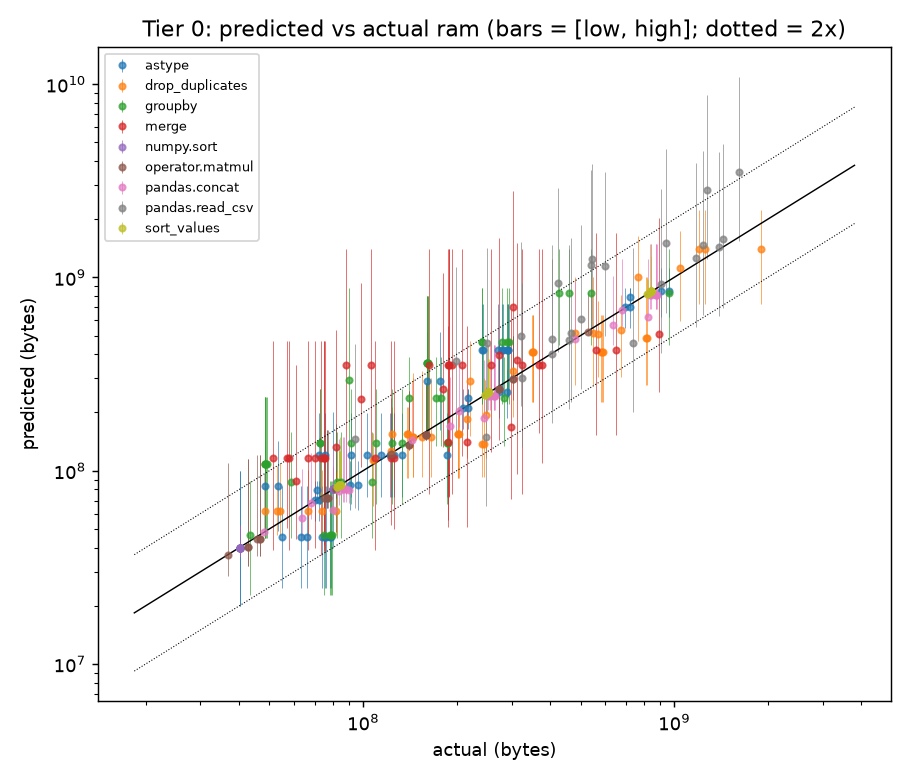
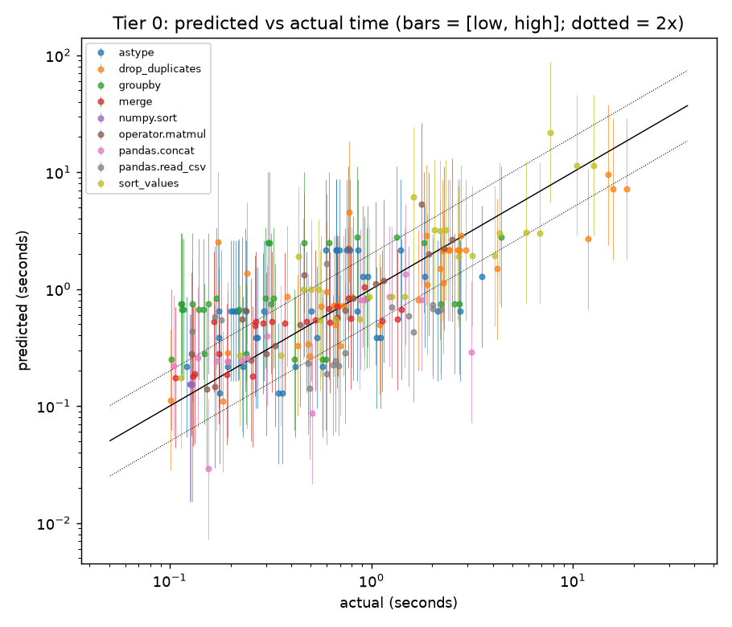
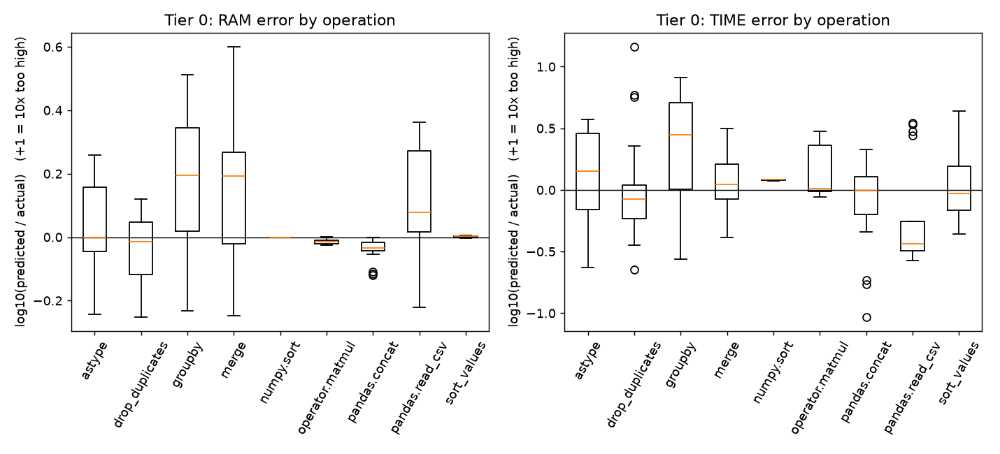
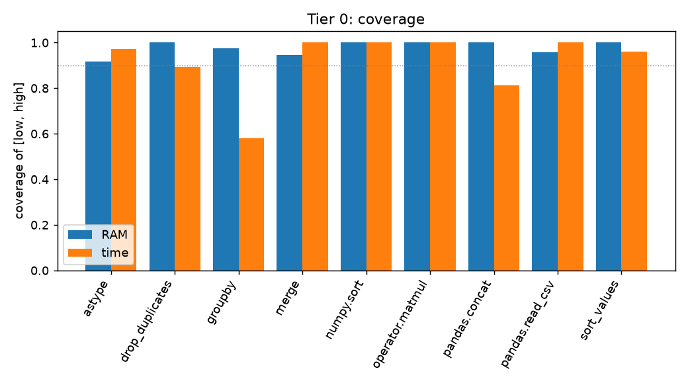
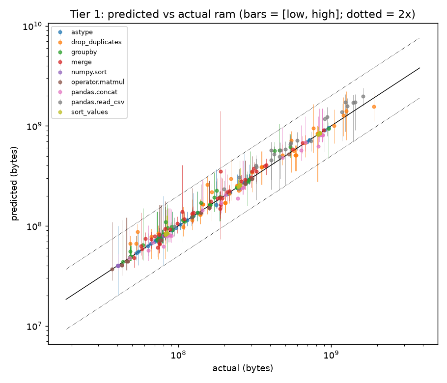
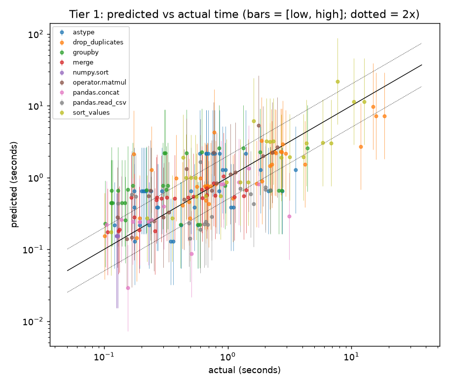
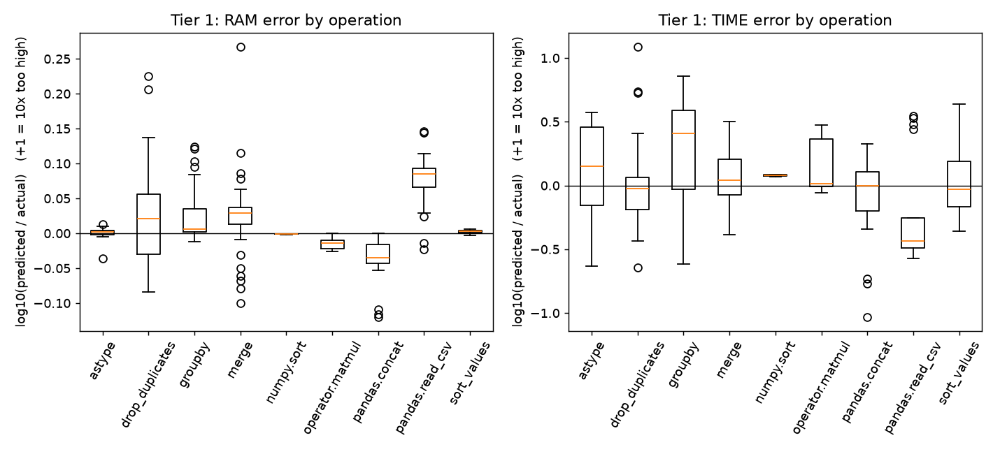
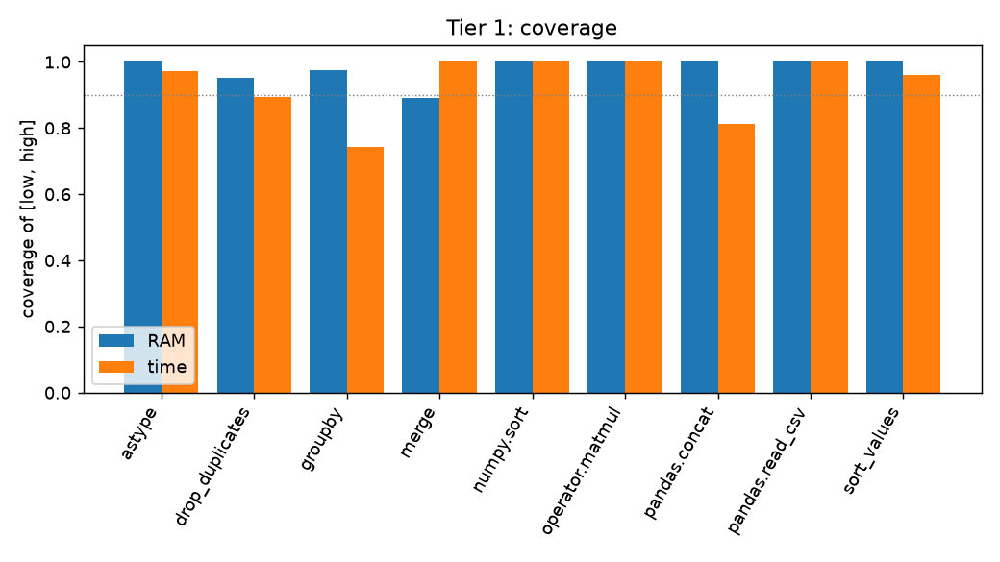

# NEXUS benchmark report (development): `full`

Instrument `os-peak-v2`. Windows-11-10.0.26200-SP0, Python 3.12.5, pandas 3.1.1 (default string dtype `str`, generated text columns `object`), numpy 2.5.5, pyarrow none, CPU Intel64 Family 6 Model 186 Stepping 2, GenuineIntel (16 logical, max 2400 MHz), git `4772f9a`. Memory cap per child process: 2560 MB. Machine profile calibrated: True.

Floors: RAM >= 32 MiB above baseline, time >= 100 ms, relative spread <= 30%. Points below a floor are *censored*; points above the spread threshold are *excluded*; accuracy covers *valid* points only.

## Dev split

Grid points by outcome: {'ok': 322, 'skipped_cap': 37, 'memory_limit': 1}.

### Classification of measurements (all points that ran)

| op | points | ram_valid | ram_cens_setup_peak | ram_cens_floor | ram_excluded | time_valid | time_cens_setup_peak | time_cens_floor | time_excluded |
|---|---|---|---|---|---|---|---|---|---|
| astype | 63 | 49 | 3 | 11 | 0 | 37 | 0 | 25 | 1 |
| drop_duplicates | 46 | 40 | 3 | 3 | 0 | 38 | 0 | 7 | 1 |
| groupby | 51 | 41 | 0 | 10 | 0 | 31 | 0 | 18 | 2 |
| merge | 37 | 37 | 0 | 0 | 0 | 24 | 0 | 6 | 7 |
| numpy.sort | 16 | 12 | 0 | 4 | 0 | 3 | 0 | 13 | 0 |
| operator.matmul | 29 | 24 | 0 | 5 | 0 | 19 | 0 | 9 | 1 |
| pandas.concat | 27 | 27 | 0 | 0 | 0 | 16 | 0 | 10 | 1 |
| pandas.read_csv | 24 | 24 | 0 | 0 | 0 | 17 | 0 | 4 | 3 |
| sort_values | 29 | 29 | 0 | 0 | 0 | 26 | 0 | 0 | 3 |
| ALL | 322 | 283 | 6 | 33 | 0 | 211 | 0 | 92 | 19 |

`cens_setup_peak` = operation never exceeded the peak reached while loading inputs; `cens_floor` = measured but below the floor.

### Instrument cross-check (OS peak vs polled RSS)

| op | uncensored_runs | poll_over_os | poll_missed_half | median_poll_ratio |
|---|---|---|---|---|
| astype | 180 | 0 | 4 | 0.99 |
| drop_duplicates | 129 | 0 | 0 | 0.99 |
| groupby | 153 | 0 | 0 | 0.97 |
| merge | 111 | 0 | 0 | 0.96 |
| numpy.sort | 48 | 0 | 4 | 1.00 |
| operator.matmul | 87 | 0 | 0 | 1.00 |
| pandas.concat | 81 | 0 | 5 | 0.95 |
| pandas.read_csv | 72 | 0 | 0 | 0.99 |
| sort_values | 87 | 0 | 0 | 0.97 |
| ALL | 948 | 0 | 13 | 0.99 |

`poll_over_os` should be 0 (polling can only under-measure). `poll_missed_half` = runs where polling saw less than half of the OS peak.

### Tier 0

#### Estimate availability and sample sizes

| op | points | estimated | ram_valid | ram_censored | ram_excluded | time_valid | time_censored | time_excluded |
|---|---|---|---|---|---|---|---|---|
| astype | 63 | 63 | 49 | 14 | 0 | 37 | 25 | 1 |
| drop_duplicates | 47 | 47 | 41 | 6 | 0 | 38 | 7 | 1 |
| groupby | 51 | 51 | 41 | 10 | 0 | 31 | 18 | 2 |
| merge | 37 | 37 | 37 | 0 | 0 | 24 | 6 | 7 |
| numpy.sort | 16 | 16 | 12 | 4 | 0 | 3 | 13 | 0 |
| operator.matmul | 29 | 29 | 24 | 5 | 0 | 19 | 9 | 1 |
| pandas.concat | 27 | 27 | 27 | 0 | 0 | 16 | 10 | 1 |
| pandas.read_csv | 24 | 24 | 24 | 0 | 0 | 17 | 4 | 3 |
| sort_values | 29 | 29 | 29 | 0 | 0 | 26 | 0 | 3 |
| ALL | 323 | 323 | 284 | 39 | 0 | 211 | 92 | 19 |

#### RAM accuracy (valid points)

| op | ram_n | ram_err_med | ram_err_p90 | ram_bias | ram_cov | ram_above_high | ram_below_low | ram_width |
|---|---|---|---|---|---|---|---|---|
| astype | 49 | 17% | 65% | 1.00 | 92% | 0% | 8% | 99% |
| drop_duplicates | 41 | 17% | 32% | 0.97 | 100% | 0% | 0% | 106% |
| groupby | 41 | 57% | 124% | 1.57 | 98% | 0% | 2% | 147% |
| merge | 37 | 55% | 129% | 1.55 | 95% | 0% | 5% | 366% |
| numpy.sort | 12 | 0% | 0% | 1.00 | 100% | 0% | 0% | 40% |
| operator.matmul | 24 | 3% | 6% | 0.97 | 100% | 0% | 0% | 125% |
| pandas.concat | 27 | 8% | 16% | 0.92 | 100% | 0% | 0% | 100% |
| pandas.read_csv | 24 | 39% | 120% | 1.20 | 96% | 0% | 4% | 265% |
| sort_values | 29 | 1% | 1% | 1.01 | 100% | 0% | 0% | 45% |
| ALL | 284 | 12% | 91% | 1.00 | 97% | 0% | 3% | 150% |

#### Time accuracy (valid points)

| op | time_n | time_err_med | time_err_p90 | time_bias | time_cov | time_above_high | time_below_low | time_width |
|---|---|---|---|---|---|---|---|---|
| astype | 37 | 65% | 223% | 1.42 | 97% | 3% | 0% | 375% |
| drop_duplicates | 38 | 34% | 92% | 0.84 | 89% | 3% | 8% | 375% |
| groupby | 31 | 180% | 555% | 2.80 | 58% | 0% | 42% | 375% |
| merge | 24 | 38% | 82% | 1.10 | 100% | 0% | 0% | 375% |
| numpy.sort | 3 | 21% | 22% | 1.21 | 100% | 0% | 0% | 390% |
| operator.matmul | 19 | 9% | 185% | 1.03 | 100% | 0% | 0% | 480% |
| pandas.concat | 16 | 31% | 90% | 0.99 | 81% | 19% | 0% | 375% |
| pandas.read_csv | 17 | 68% | 216% | 0.37 | 100% | 0% | 0% | 375% |
| sort_values | 26 | 40% | 151% | 0.93 | 96% | 0% | 4% | 375% |
| ALL | 211 | 53% | 239% | 1.07 | 90% | 2% | 8% | 385% |

`above_high` = actual exceeded the predicted high (under-prediction beyond the range); `below_low` = actual fell under the predicted low. bias = median(expected / actual).

#### Time as an order-of-magnitude bucket (what the user is shown)

| op | time_n | same | within_one | range_hit | repeat_spread_med | repeat_spread_p90 |
|---|---|---|---|---|---|---|
| astype | 37 | 0.65 | 1.00 | 1.00 | 0.06 | 0.16 |
| drop_duplicates | 38 | 0.76 | 1.00 | 0.97 | 0.07 | 0.20 |
| groupby | 31 | 0.74 | 1.00 | 1.00 | 0.08 | 0.17 |
| merge | 24 | 0.83 | 1.00 | 1.00 | 0.11 | 0.13 |
| numpy.sort | 3 | 1.00 | 1.00 | 1.00 | 0.09 | 0.10 |
| operator.matmul | 19 | 0.89 | 1.00 | 1.00 | 0.08 | 0.18 |
| pandas.concat | 16 | 0.69 | 1.00 | 1.00 | 0.11 | 0.15 |
| pandas.read_csv | 17 | 0.59 | 1.00 | 1.00 | 0.06 | 0.20 |
| sort_values | 26 | 0.85 | 1.00 | 1.00 | 0.07 | 0.14 |
| ALL | 211 | 0.75 | 1.00 | 1.00 | 0.08 | 0.17 |

Buckets: under 0.1 s, 0.1-1 s, 1-10 s, 10-60 s, 1-10 min, over 10 min. `same` / `within_one` compare the expected bucket with the measured one; `range_hit` = measured bucket inside the buckets of low..high; `repeat_spread_*` = run-to-run noise of the measurement. The time models stay first drafts (Phase 6 inputs: read_csv under-predicted, groupby / astype / float32 matmul over-predicted).

#### Per case (configuration) detail

| case | ram_n | ram_bias | ram_cov | time_n | time_bias | time_cov |
|---|---|---|---|---|---|---|
| astype/datetime_to_str | 3.00 | 1.10 | 100% | 3.00 | 0.71 | 100% |
| astype/float_to_float32 | 1.00 | 1.00 | 100% | – | – | – |
| astype/int_to_float64 | 1.00 | 1.00 | 100% | – | – | – |
| astype/int_to_int32 | 1.00 | 1.00 | 100% | – | – | – |
| astype/int_to_str | 3.00 | 0.88 | 100% | 2.00 | 1.43 | 100% |
| astype/str_to_category_highcard | 2.00 | 0.74 | 100% | 2.00 | 0.41 | 100% |
| astype/str_to_category_lowcard | 2.00 | 1.41 | 100% | 2.00 | 3.18 | 100% |
| astype/str_to_category_zipf | 3.00 | 0.99 | 100% | 2.00 | 2.92 | 100% |
| v3/astype/float_to_str | 3.00 | 0.97 | 100% | 2.00 | 0.35 | 100% |
| v3/astype/int_to_category_card0p04 | 2.00 | 1.61 | 100% | 1.00 | 2.20 | 100% |
| v3/astype/int_to_int16 | – | – | – | – | – | – |
| v3/astype/str_to_category_card0p75 | 2.00 | 0.61 | 100% | 2.00 | 0.31 | 50% |
| v3/astype/str_to_category_card12000 | 3.00 | 1.05 | 100% | 2.00 | 2.75 | 100% |
| v3/astype/str_to_category_card25 | 2.00 | 1.70 | 0% | 2.00 | 3.68 | 100% |
| v4/astype/float_to_str_nulls | 3.00 | 1.01 | 100% | 3.00 | 0.36 | 100% |
| v4/astype/int_to_category_card15000 | 2.00 | 1.77 | 0% | – | – | – |
| v4/astype/int_to_str_card1500 | 3.00 | 0.93 | 100% | 2.00 | 1.37 | 100% |
| v4/astype/str_to_category_card0p12 | 2.00 | 0.78 | 100% | 2.00 | 0.94 | 100% |
| v4/astype/str_to_category_card150000 | 3.00 | 0.97 | 100% | 3.00 | 1.28 | 100% |
| v4/astype/str_to_category_card40000 | 3.00 | 0.98 | 100% | 3.00 | 2.23 | 100% |
| v4/astype/str_to_category_card400_long | 2.00 | 1.66 | 100% | 2.00 | 3.19 | 100% |
| v4/astype/str_to_category_card6000 | 3.00 | 1.17 | 100% | 2.00 | 3.14 | 100% |
| drop_duplicates/mixed_dup0 | 3.00 | 1.17 | 100% | 3.00 | 0.79 | 100% |
| drop_duplicates/mixed_dup50 | 3.00 | 1.17 | 100% | 3.00 | 0.88 | 100% |
| drop_duplicates/numeric_dup50 | 3.00 | 1.08 | 100% | 3.00 | 0.47 | 67% |
| drop_duplicates/realistic_nulls_dup30 | 2.00 | 0.73 | 100% | 2.00 | 0.93 | 100% |
| drop_duplicates/strings_dup50 | 3.00 | 1.32 | 100% | 3.00 | 1.03 | 100% |
| drop_duplicates/subset_i0_s0_lowcard | 3.00 | 0.59 | 100% | 2.00 | 1.90 | 100% |
| drop_duplicates/subset_s0_lowcard | – | – | – | 1.00 | 14.57 | 0% |
| v3/drop_duplicates/high_survivor_subset_i0_d0 | 3.00 | 0.60 | 100% | 3.00 | 0.70 | 100% |
| v3/drop_duplicates/null_heavy_full | 3.00 | 0.74 | 100% | 2.00 | 0.97 | 100% |
| v3/drop_duplicates/null_subset_f0_s0 | 2.00 | 1.10 | 100% | 2.00 | 1.28 | 100% |
| v3/drop_duplicates/numeric_wide_nulls | 2.00 | 0.88 | 100% | 2.00 | 0.71 | 100% |
| v4/drop_duplicates/int_subset_lowdup | – | – | – | – | – | – |
| v4/drop_duplicates/no_nulls_full | 2.00 | 1.14 | 100% | 2.00 | 0.87 | 100% |
| v4/drop_duplicates/null_heavy_full | 2.00 | 0.73 | 100% | 2.00 | 1.11 | 100% |
| v4/drop_duplicates/null_subset_cat_date | 3.00 | 0.93 | 100% | 2.00 | 0.67 | 100% |
| v4/drop_duplicates/null_subset_floats | 2.00 | 1.06 | 100% | 2.00 | 0.53 | 100% |
| v4/drop_duplicates/null_subset_texts | 3.00 | 1.07 | 100% | 2.00 | 5.77 | 0% |
| v4/drop_duplicates/numeric_wide_nulls12 | 2.00 | 0.79 | 100% | 2.00 | 0.41 | 100% |
| groupby/cat_key_zipf_sum | 1.00 | 3.25 | 100% | 1.00 | 6.59 | 0% |
| groupby/int_sum_numeric | 2.00 | 2.24 | 100% | 1.00 | 3.04 | 100% |
| groupby/str_highcard_sum_f0 | 2.00 | 0.82 | 100% | 2.00 | 0.47 | 100% |
| groupby/str_lowcard_sum_f0 | 2.00 | 1.59 | 100% | 2.00 | 5.60 | 0% |
| groupby/two_keys_mean_realistic | 3.00 | 1.34 | 100% | 2.00 | 2.32 | 100% |
| v3/groupby/int_card20000_mean | 2.00 | 2.24 | 100% | 1.00 | 4.80 | 0% |
| v3/groupby/str_card0p04_two_values | 3.00 | 1.12 | 100% | 3.00 | 2.37 | 100% |
| v3/groupby/str_card0p75_sum | 2.00 | 0.67 | 100% | 2.00 | 0.36 | 100% |
| v3/groupby/str_card12_sum | 2.00 | 1.92 | 100% | 1.00 | 8.02 | 0% |
| v3/groupby/two_keys_card800 | 3.00 | 1.39 | 100% | 3.00 | 2.80 | 100% |
| v3/groupby/zipf_int_card0p0004 | 2.00 | 2.25 | 100% | 1.00 | 5.75 | 0% |
| v4/groupby/int_card40000_mean | 2.00 | 2.23 | 100% | 1.00 | 4.55 | 0% |
| v4/groupby/str_card0p003_two_values | 3.00 | 1.26 | 100% | 2.00 | 4.44 | 0% |
| v4/groupby/str_card0p9_mean | 2.00 | 0.66 | 100% | 2.00 | 0.36 | 100% |
| v4/groupby/str_card3_sum | 2.00 | 1.92 | 100% | 2.00 | 7.37 | 0% |
| v4/groupby/two_keys_card60 | 3.00 | 1.70 | 67% | 1.00 | 4.90 | 0% |
| v4/groupby/two_keys_card6000 | 3.00 | 0.84 | 100% | 3.00 | 0.88 | 100% |
| v4/groupby/zipf_int_card0p006 | 2.00 | 2.24 | 100% | 1.00 | 5.86 | 0% |
| merge/inner_1to1 | 2.00 | 2.09 | 100% | 1.00 | 1.63 | 100% |
| merge/inner_fanout3 | 2.00 | 1.79 | 100% | 1.00 | 1.10 | 100% |
| merge/inner_manymany | 2.00 | 1.07 | 100% | 1.00 | 1.65 | 100% |
| merge/inner_overlap10 | 2.00 | 3.13 | 100% | 1.00 | 3.16 | 100% |
| merge/left_1to1 | 2.00 | 2.68 | 50% | 1.00 | 1.96 | 100% |
| merge/outer_overlap50_realistic | 2.00 | 0.75 | 100% | 1.00 | 0.41 | 100% |
| merge/right_fanout4_strings | 2.00 | 1.45 | 100% | 1.00 | 1.06 | 100% |
| v3/merge/inner_bigright_fanout8 | 2.00 | 2.34 | 50% | 1.00 | 1.13 | 100% |
| v3/merge/inner_overlap25_fanout6 | 2.00 | 1.70 | 100% | 1.00 | 1.75 | 100% |
| v3/merge/left_overlap90_fanout1p2 | 2.00 | 0.95 | 100% | 2.00 | 0.84 | 100% |
| v3/merge/outer_overlap65_zipf | 2.00 | 0.65 | 100% | 2.00 | 0.59 | 100% |
| v3/merge/right_overlap05_text | 2.00 | 1.54 | 100% | 2.00 | 1.35 | 100% |
| v4/merge/inner_overlap20_fanout10 | 2.00 | 1.73 | 100% | 1.00 | 1.84 | 100% |
| v4/merge/inner_overlap35_fanout7 | 2.00 | 1.70 | 100% | 1.00 | 1.39 | 100% |
| v4/merge/inner_overlap55_fanout4p5 | 2.00 | 1.46 | 100% | 2.00 | 1.13 | 100% |
| v4/merge/inner_overlap95_fanout1p1 | 2.00 | 1.68 | 100% | 2.00 | 1.20 | 100% |
| v4/merge/left_overlap40_fanout9 | 2.00 | 0.93 | 100% | 1.00 | 0.84 | 100% |
| v4/merge/outer_overlap70_zipf1p5 | 2.00 | 0.57 | 100% | 1.00 | 0.48 | 100% |
| v4/merge/right_overlap15_text | 1.00 | 1.20 | 100% | 1.00 | 1.11 | 100% |
| np_sort/float32_random | 1.00 | 1.00 | 100% | – | – | – |
| np_sort/random | 2.00 | 1.00 | 100% | 1.00 | 1.21 | 100% |
| np_sort/reverse | 2.00 | 1.00 | 100% | 1.00 | 1.22 | 100% |
| np_sort/sorted | 2.00 | 1.00 | 100% | 1.00 | 1.18 | 100% |
| v3/np_sort/float32_reverse | 1.00 | 1.00 | 100% | – | – | – |
| v3/np_sort/int32_random | 1.00 | 1.00 | 100% | – | – | – |
| v4/np_sort/float32_nearly_sorted | 1.00 | 1.00 | 100% | – | – | – |
| v4/np_sort/int64_random | 2.00 | 1.00 | 100% | – | – | – |
| matmul/rect_f64 | 5.00 | 0.98 | 100% | 4.00 | 1.02 | 100% |
| matmul/square_f64 | 4.00 | 0.97 | 100% | 3.00 | 0.92 | 100% |
| v3/matmul/float32_square | 4.00 | 0.96 | 100% | 4.00 | 2.84 | 100% |
| v3/matmul/wide_rect | 3.00 | 0.99 | 100% | 3.00 | 1.02 | 100% |
| v4/matmul/float32_thin | 4.00 | 0.96 | 100% | 2.00 | 2.64 | 100% |
| v4/matmul/three_quarter_rect | 4.00 | 0.96 | 100% | 3.00 | 1.03 | 100% |
| concat/mixed | 3.00 | 0.92 | 100% | 2.00 | 0.76 | 100% |
| concat/numeric | 3.00 | 1.00 | 100% | 1.00 | 1.88 | 100% |
| concat/realistic_nulls | 3.00 | 0.92 | 100% | 2.00 | 0.88 | 100% |
| concat/three_frames | 3.00 | 0.95 | 100% | 1.00 | 1.26 | 100% |
| v3/concat/four_frames_light_nulls | 3.00 | 0.96 | 100% | 2.00 | 1.06 | 100% |
| v3/concat/two_numeric_unequal | 3.00 | 1.00 | 100% | 1.00 | 2.12 | 100% |
| v3/concat/two_strings_long | 3.00 | 0.89 | 100% | 2.00 | 1.11 | 100% |
| v4/concat/three_uneven | 3.00 | 0.92 | 100% | 2.00 | 1.18 | 100% |
| v4/concat/two_category_heavy | 3.00 | 0.77 | 100% | 3.00 | 0.17 | 0% |
| read_csv/mixed | 2.00 | 1.10 | 100% | 2.00 | 0.36 | 100% |
| read_csv/numeric | 2.00 | 1.88 | 100% | – | – | – |
| read_csv/realistic_nulls | 2.00 | 1.57 | 100% | 2.00 | 0.52 | 100% |
| read_csv/strings | 2.00 | 1.04 | 100% | 2.00 | 0.31 | 100% |
| read_csv/wide_numeric | 2.00 | 2.17 | 100% | 2.00 | 2.88 | 100% |
| v3/read_csv/float_heavy | 2.00 | 2.22 | 100% | 1.00 | 3.39 | 100% |
| v3/read_csv/long_distinct_strings | 1.00 | 1.21 | 100% | 1.00 | 0.38 | 100% |
| v3/read_csv/mixed_nulls_dates | 2.00 | 1.18 | 100% | 2.00 | 0.34 | 100% |
| v3/read_csv/short_ints | 2.00 | 0.61 | 100% | – | – | – |
| v3/read_csv/two_columns | 2.00 | 1.69 | 100% | – | – | – |
| v4/read_csv/dates_ints | 2.00 | 1.03 | 100% | 2.00 | 0.35 | 100% |
| v4/read_csv/text_nulls | 2.00 | 0.98 | 100% | 2.00 | 0.28 | 100% |
| v4/read_csv/wide_floats | 1.00 | 2.31 | 0% | 1.00 | 3.49 | 100% |
| sort_values/by_datetime | 3.00 | 1.01 | 100% | 2.00 | 0.55 | 100% |
| sort_values/by_int | 3.00 | 1.01 | 100% | 2.00 | 0.72 | 100% |
| sort_values/by_int_float | 3.00 | 1.01 | 100% | 2.00 | 0.60 | 100% |
| sort_values/by_str | 3.00 | 1.01 | 100% | 3.00 | 1.37 | 100% |
| sort_values/by_str_desc_nulls | 2.00 | 1.01 | 100% | 2.00 | 1.86 | 100% |
| v3/sort_values/float_desc_nulls | 3.00 | 1.01 | 100% | 3.00 | 0.97 | 100% |
| v3/sort_values/int_datetime_lowcard | 3.00 | 1.00 | 100% | 3.00 | 0.58 | 100% |
| v3/sort_values/two_str_keys | 3.00 | 1.00 | 100% | 3.00 | 3.77 | 67% |
| v4/sort_values/float_int_lowcard | 3.00 | 1.00 | 100% | 3.00 | 0.88 | 100% |
| v4/sort_values/str_desc_nulls | 3.00 | 1.00 | 100% | 3.00 | 1.45 | 100% |

#### OOM warnings (simulated memory limits)

| limit_mb | rule | positives | tp | fp | fn | tn | precision | recall |
|---|---|---|---|---|---|---|---|---|
| 64 | high | 314 | 314 | 5 | 0 | 4 | 98% | 100% |
| 64 | expected | 314 | 314 | 0 | 0 | 9 | 100% | 100% |
| 128 | high | 297 | 297 | 10 | 0 | 16 | 97% | 100% |
| 128 | expected | 297 | 296 | 1 | 1 | 25 | 100% | 100% |
| 256 | high | 228 | 224 | 30 | 4 | 65 | 88% | 98% |
| 256 | expected | 228 | 218 | 4 | 10 | 91 | 98% | 96% |
| 512 | high | 172 | 172 | 34 | 0 | 117 | 83% | 100% |
| 512 | expected | 172 | 169 | 10 | 3 | 141 | 94% | 98% |
| 1024 | high | 78 | 78 | 37 | 0 | 208 | 68% | 100% |
| 1024 | expected | 78 | 76 | 7 | 2 | 238 | 92% | 97% |
| 2048 | high | 30 | 30 | 44 | 0 | 249 | 41% | 100% |
| 2048 | expected | 30 | 30 | 13 | 0 | 280 | 70% | 100% |
| 4096 | high | 0 | 0 | 7 | 0 | 315 | 0% | – |
| 4096 | expected | 0 | 0 | 1 | 0 | 321 | 0% | – |

#### Analysis overhead (budget 250 ms)

| op | n | cold_med_ms | cold_p90_ms | warm_med_ms | warm_max_ms | over_budget |
|---|---|---|---|---|---|---|
| astype | 63 | 4.86 | 7.20 | 4.29 | 11.08 | 0 |
| drop_duplicates | 47 | 4.69 | 6.90 | 3.55 | 13.70 | 0 |
| groupby | 51 | 3.98 | 6.40 | 3.53 | 8.58 | 0 |
| merge | 37 | 8.35 | 12.45 | 6.92 | 13.22 | 0 |
| numpy.sort | 16 | 0.66 | 0.93 | 0.26 | 0.46 | 0 |
| operator.matmul | 29 | 0.53 | 0.91 | 0.19 | 0.58 | 0 |
| pandas.concat | 27 | 10.47 | 17.06 | 8.69 | 18.99 | 0 |
| pandas.read_csv | 24 | 0.48 | 0.72 | 0.17 | 0.66 | 0 |
| sort_values | 29 | 5.29 | 7.71 | 4.68 | 7.99 | 0 |
| ALL | 323 | 4.24 | 9.29 | 3.67 | 18.99 | 0 |

#### Figures

#### Ten worst RAM predictions (valid points)

| point_id | actual_MB | expected_MB | low_MB | high_MB |
|---|---|---|---|---|
| merge/inner_overlap10|n=3000000 | 83.78 | 334 | 72.42 | 1337 |
| merge/left_1to1|n=3000000 | 101 | 334 | 105 | 1337 |
| groupby/cat_key_zipf_sum|n=10000000 | 86.11 | 280 | 85.98 | 839 |
| v3/merge/inner_bigright_fanout8|n=1000000 | 94.19 | 223 | 99.51 | 891 |
| v3/merge/inner_bigright_fanout8|n=3000000 | 290 | 668 | 221 | 2673 |
| v4/read_csv/wide_floats|n=1000000 | 517 | 1194 | 522 | 3683 |
| merge/inner_overlap10|n=1000000 | 49.07 | 111 | 37.14 | 446 |
| v3/groupby/zipf_int_card0p0004|n=10000000 | 153 | 344 | 143 | 763 |
| v3/groupby/int_card20000_mean|n=10000000 | 153 | 344 | 143 | 763 |
| groupby/int_sum_numeric|n=10000000 | 153 | 344 | 143 | 763 |

### Tier 1

#### Estimate availability and sample sizes

| op | points | estimated | ram_valid | ram_censored | ram_excluded | time_valid | time_censored | time_excluded |
|---|---|---|---|---|---|---|---|---|
| astype | 63 | 63 | 49 | 14 | 0 | 37 | 25 | 1 |
| drop_duplicates | 47 | 47 | 41 | 6 | 0 | 38 | 7 | 1 |
| groupby | 51 | 51 | 41 | 10 | 0 | 31 | 18 | 2 |
| merge | 37 | 37 | 37 | 0 | 0 | 24 | 6 | 7 |
| numpy.sort | 16 | 16 | 12 | 4 | 0 | 3 | 13 | 0 |
| operator.matmul | 29 | 29 | 24 | 5 | 0 | 19 | 9 | 1 |
| pandas.concat | 27 | 27 | 27 | 0 | 0 | 16 | 10 | 1 |
| pandas.read_csv | 24 | 24 | 24 | 0 | 0 | 17 | 4 | 3 |
| sort_values | 29 | 29 | 29 | 0 | 0 | 26 | 0 | 3 |
| ALL | 323 | 323 | 284 | 39 | 0 | 211 | 92 | 19 |

#### RAM accuracy (valid points)

| op | ram_n | ram_err_med | ram_err_p90 | ram_bias | ram_cov | ram_above_high | ram_below_low | ram_width |
|---|---|---|---|---|---|---|---|---|
| astype | 49 | 1% | 1% | 1.00 | 100% | 0% | 0% | 45% |
| drop_duplicates | 41 | 12% | 32% | 1.05 | 95% | 0% | 5% | 66% |
| groupby | 41 | 2% | 21% | 1.01 | 98% | 0% | 2% | 56% |
| merge | 37 | 8% | 20% | 1.07 | 89% | 8% | 3% | 56% |
| numpy.sort | 12 | 0% | 0% | 1.00 | 100% | 0% | 0% | 40% |
| operator.matmul | 24 | 3% | 6% | 0.97 | 100% | 0% | 0% | 125% |
| pandas.concat | 27 | 8% | 16% | 0.92 | 100% | 0% | 0% | 100% |
| pandas.read_csv | 24 | 22% | 30% | 1.22 | 100% | 0% | 0% | 58% |
| sort_values | 29 | 1% | 1% | 1.01 | 100% | 0% | 0% | 45% |
| ALL | 284 | 3% | 22% | 1.01 | 98% | 1% | 1% | 64% |

#### Time accuracy (valid points)

| op | time_n | time_err_med | time_err_p90 | time_bias | time_cov | time_above_high | time_below_low | time_width |
|---|---|---|---|---|---|---|---|---|
| astype | 37 | 65% | 223% | 1.42 | 97% | 3% | 0% | 375% |
| drop_duplicates | 38 | 34% | 101% | 0.94 | 89% | 3% | 8% | 375% |
| groupby | 31 | 157% | 411% | 2.57 | 74% | 3% | 23% | 375% |
| merge | 24 | 38% | 82% | 1.10 | 100% | 0% | 0% | 375% |
| numpy.sort | 3 | 21% | 22% | 1.21 | 100% | 0% | 0% | 390% |
| operator.matmul | 19 | 9% | 185% | 1.03 | 100% | 0% | 0% | 480% |
| pandas.concat | 16 | 31% | 90% | 0.99 | 81% | 19% | 0% | 375% |
| pandas.read_csv | 17 | 68% | 216% | 0.37 | 100% | 0% | 0% | 375% |
| sort_values | 26 | 40% | 151% | 0.93 | 96% | 0% | 4% | 375% |
| ALL | 211 | 53% | 224% | 1.07 | 92% | 3% | 5% | 385% |

`above_high` = actual exceeded the predicted high (under-prediction beyond the range); `below_low` = actual fell under the predicted low. bias = median(expected / actual).

#### Time as an order-of-magnitude bucket (what the user is shown)

| op | time_n | same | within_one | range_hit | repeat_spread_med | repeat_spread_p90 |
|---|---|---|---|---|---|---|
| astype | 37 | 0.65 | 1.00 | 1.00 | 0.06 | 0.16 |
| drop_duplicates | 38 | 0.74 | 1.00 | 0.97 | 0.07 | 0.20 |
| groupby | 31 | 0.74 | 1.00 | 1.00 | 0.08 | 0.17 |
| merge | 24 | 0.83 | 1.00 | 1.00 | 0.11 | 0.13 |
| numpy.sort | 3 | 1.00 | 1.00 | 1.00 | 0.09 | 0.10 |
| operator.matmul | 19 | 0.89 | 1.00 | 1.00 | 0.08 | 0.18 |
| pandas.concat | 16 | 0.69 | 1.00 | 1.00 | 0.11 | 0.15 |
| pandas.read_csv | 17 | 0.59 | 1.00 | 1.00 | 0.06 | 0.20 |
| sort_values | 26 | 0.85 | 1.00 | 1.00 | 0.07 | 0.14 |
| ALL | 211 | 0.75 | 1.00 | 1.00 | 0.08 | 0.17 |

Buckets: under 0.1 s, 0.1-1 s, 1-10 s, 10-60 s, 1-10 min, over 10 min. `same` / `within_one` compare the expected bucket with the measured one; `range_hit` = measured bucket inside the buckets of low..high; `repeat_spread_*` = run-to-run noise of the measurement. The time models stay first drafts (Phase 6 inputs: read_csv under-predicted, groupby / astype / float32 matmul over-predicted).

#### Per case (configuration) detail

| case | ram_n | ram_bias | ram_cov | time_n | time_bias | time_cov |
|---|---|---|---|---|---|---|
| astype/datetime_to_str | 3.00 | 1.00 | 100% | 3.00 | 0.71 | 100% |
| astype/float_to_float32 | 1.00 | 1.00 | 100% | – | – | – |
| astype/int_to_float64 | 1.00 | 1.00 | 100% | – | – | – |
| astype/int_to_int32 | 1.00 | 1.00 | 100% | – | – | – |
| astype/int_to_str | 3.00 | 1.00 | 100% | 2.00 | 1.43 | 100% |
| astype/str_to_category_highcard | 2.00 | 1.02 | 100% | 2.00 | 0.41 | 100% |
| astype/str_to_category_lowcard | 2.00 | 1.01 | 100% | 2.00 | 3.18 | 100% |
| astype/str_to_category_zipf | 3.00 | 1.00 | 100% | 2.00 | 2.92 | 100% |
| v3/astype/float_to_str | 3.00 | 1.00 | 100% | 2.00 | 0.35 | 100% |
| v3/astype/int_to_category_card0p04 | 2.00 | 0.97 | 100% | 1.00 | 2.20 | 100% |
| v3/astype/int_to_int16 | – | – | – | – | – | – |
| v3/astype/str_to_category_card0p75 | 2.00 | 1.03 | 100% | 2.00 | 0.31 | 50% |
| v3/astype/str_to_category_card12000 | 3.00 | 1.01 | 100% | 2.00 | 2.75 | 100% |
| v3/astype/str_to_category_card25 | 2.00 | 1.01 | 100% | 2.00 | 3.68 | 100% |
| v4/astype/float_to_str_nulls | 3.00 | 1.00 | 100% | 3.00 | 0.36 | 100% |
| v4/astype/int_to_category_card15000 | 2.00 | 1.01 | 100% | – | – | – |
| v4/astype/int_to_str_card1500 | 3.00 | 1.00 | 100% | 2.00 | 1.37 | 100% |
| v4/astype/str_to_category_card0p12 | 2.00 | 1.00 | 100% | 2.00 | 0.94 | 100% |
| v4/astype/str_to_category_card150000 | 3.00 | 1.01 | 100% | 3.00 | 1.28 | 100% |
| v4/astype/str_to_category_card40000 | 3.00 | 1.01 | 100% | 3.00 | 2.23 | 100% |
| v4/astype/str_to_category_card400_long | 2.00 | 1.01 | 100% | 2.00 | 3.19 | 100% |
| v4/astype/str_to_category_card6000 | 3.00 | 1.01 | 100% | 2.00 | 3.14 | 100% |
| drop_duplicates/mixed_dup0 | 3.00 | 1.11 | 100% | 3.00 | 0.83 | 100% |
| drop_duplicates/mixed_dup50 | 3.00 | 1.05 | 100% | 3.00 | 0.90 | 100% |
| drop_duplicates/numeric_dup50 | 3.00 | 0.96 | 100% | 3.00 | 0.48 | 67% |
| drop_duplicates/realistic_nulls_dup30 | 2.00 | 0.86 | 100% | 2.00 | 0.99 | 100% |
| drop_duplicates/strings_dup50 | 3.00 | 1.24 | 100% | 3.00 | 1.05 | 100% |
| drop_duplicates/subset_i0_s0_lowcard | 3.00 | 1.05 | 100% | 2.00 | 2.17 | 100% |
| drop_duplicates/subset_s0_lowcard | – | – | – | 1.00 | 12.29 | 0% |
| v3/drop_duplicates/high_survivor_subset_i0_d0 | 3.00 | 1.03 | 100% | 3.00 | 0.94 | 100% |
| v3/drop_duplicates/null_heavy_full | 3.00 | 0.84 | 100% | 2.00 | 1.02 | 100% |
| v3/drop_duplicates/null_subset_f0_s0 | 2.00 | 1.20 | 50% | 2.00 | 1.21 | 100% |
| v3/drop_duplicates/numeric_wide_nulls | 2.00 | 0.98 | 100% | 2.00 | 0.69 | 100% |
| v4/drop_duplicates/int_subset_lowdup | – | – | – | – | – | – |
| v4/drop_duplicates/no_nulls_full | 2.00 | 1.03 | 100% | 2.00 | 0.90 | 100% |
| v4/drop_duplicates/null_heavy_full | 2.00 | 0.85 | 100% | 2.00 | 1.16 | 100% |
| v4/drop_duplicates/null_subset_cat_date | 3.00 | 1.31 | 100% | 2.00 | 0.71 | 100% |
| v4/drop_duplicates/null_subset_floats | 2.00 | 1.64 | 100% | 2.00 | 0.69 | 100% |
| v4/drop_duplicates/null_subset_texts | 3.00 | 1.14 | 67% | 2.00 | 5.40 | 0% |
| v4/drop_duplicates/numeric_wide_nulls12 | 2.00 | 0.96 | 100% | 2.00 | 0.42 | 100% |
| groupby/cat_key_zipf_sum | 1.00 | 1.09 | 100% | 1.00 | 3.89 | 100% |
| groupby/int_sum_numeric | 2.00 | 1.01 | 100% | 1.00 | 3.04 | 100% |
| groupby/str_highcard_sum_f0 | 2.00 | 1.02 | 100% | 2.00 | 0.41 | 100% |
| groupby/str_lowcard_sum_f0 | 2.00 | 1.01 | 100% | 2.00 | 4.92 | 0% |
| groupby/two_keys_mean_realistic | 3.00 | 1.27 | 100% | 2.00 | 2.13 | 100% |
| v3/groupby/int_card20000_mean | 2.00 | 1.01 | 100% | 1.00 | 3.16 | 100% |
| v3/groupby/str_card0p04_two_values | 3.00 | 1.00 | 100% | 3.00 | 2.15 | 100% |
| v3/groupby/str_card0p75_sum | 2.00 | 1.03 | 100% | 2.00 | 0.31 | 100% |
| v3/groupby/str_card12_sum | 2.00 | 1.01 | 100% | 1.00 | 7.04 | 0% |
| v3/groupby/two_keys_card800 | 3.00 | 1.13 | 100% | 3.00 | 2.57 | 100% |
| v3/groupby/zipf_int_card0p0004 | 2.00 | 1.01 | 100% | 1.00 | 3.78 | 100% |
| v4/groupby/int_card40000_mean | 2.00 | 1.00 | 100% | 1.00 | 2.99 | 100% |
| v4/groupby/str_card0p003_two_values | 3.00 | 1.00 | 100% | 2.00 | 4.03 | 50% |
| v4/groupby/str_card0p9_mean | 2.00 | 1.04 | 100% | 2.00 | 0.31 | 50% |
| v4/groupby/str_card3_sum | 2.00 | 1.01 | 100% | 2.00 | 6.47 | 0% |
| v4/groupby/two_keys_card60 | 3.00 | 1.21 | 67% | 1.00 | 4.49 | 0% |
| v4/groupby/two_keys_card6000 | 3.00 | 0.98 | 100% | 3.00 | 0.81 | 100% |
| v4/groupby/zipf_int_card0p006 | 2.00 | 1.07 | 100% | 1.00 | 3.86 | 100% |
| merge/inner_1to1 | 2.00 | 1.04 | 100% | 1.00 | 1.63 | 100% |
| merge/inner_fanout3 | 2.00 | 1.05 | 100% | 1.00 | 1.10 | 100% |
| merge/inner_manymany | 2.00 | 1.08 | 100% | 1.00 | 1.65 | 100% |
| merge/inner_overlap10 | 2.00 | 0.99 | 100% | 1.00 | 3.16 | 100% |
| merge/left_1to1 | 2.00 | 1.21 | 50% | 1.00 | 1.96 | 100% |
| merge/outer_overlap50_realistic | 2.00 | 1.03 | 100% | 1.00 | 0.41 | 100% |
| merge/right_fanout4_strings | 2.00 | 1.13 | 100% | 1.00 | 1.06 | 100% |
| v3/merge/inner_bigright_fanout8 | 2.00 | 1.11 | 100% | 1.00 | 1.13 | 100% |
| v3/merge/inner_overlap25_fanout6 | 2.00 | 0.86 | 50% | 1.00 | 1.75 | 100% |
| v3/merge/left_overlap90_fanout1p2 | 2.00 | 1.08 | 100% | 2.00 | 0.84 | 100% |
| v3/merge/outer_overlap65_zipf | 2.00 | 1.04 | 100% | 2.00 | 0.59 | 100% |
| v3/merge/right_overlap05_text | 2.00 | 1.10 | 100% | 2.00 | 1.35 | 100% |
| v4/merge/inner_overlap20_fanout10 | 2.00 | 0.81 | 0% | 1.00 | 1.84 | 100% |
| v4/merge/inner_overlap35_fanout7 | 2.00 | 1.37 | 100% | 1.00 | 1.39 | 100% |
| v4/merge/inner_overlap55_fanout4p5 | 2.00 | 1.09 | 100% | 2.00 | 1.13 | 100% |
| v4/merge/inner_overlap95_fanout1p1 | 2.00 | 1.09 | 100% | 2.00 | 1.20 | 100% |
| v4/merge/left_overlap40_fanout9 | 2.00 | 1.08 | 100% | 1.00 | 0.84 | 100% |
| v4/merge/outer_overlap70_zipf1p5 | 2.00 | 1.02 | 100% | 1.00 | 0.48 | 100% |
| v4/merge/right_overlap15_text | 1.00 | 1.20 | 100% | 1.00 | 1.11 | 100% |
| np_sort/float32_random | 1.00 | 1.00 | 100% | – | – | – |
| np_sort/random | 2.00 | 1.00 | 100% | 1.00 | 1.21 | 100% |
| np_sort/reverse | 2.00 | 1.00 | 100% | 1.00 | 1.22 | 100% |
| np_sort/sorted | 2.00 | 1.00 | 100% | 1.00 | 1.18 | 100% |
| v3/np_sort/float32_reverse | 1.00 | 1.00 | 100% | – | – | – |
| v3/np_sort/int32_random | 1.00 | 1.00 | 100% | – | – | – |
| v4/np_sort/float32_nearly_sorted | 1.00 | 1.00 | 100% | – | – | – |
| v4/np_sort/int64_random | 2.00 | 1.00 | 100% | – | – | – |
| matmul/rect_f64 | 5.00 | 0.98 | 100% | 4.00 | 1.02 | 100% |
| matmul/square_f64 | 4.00 | 0.97 | 100% | 3.00 | 0.92 | 100% |
| v3/matmul/float32_square | 4.00 | 0.96 | 100% | 4.00 | 2.84 | 100% |
| v3/matmul/wide_rect | 3.00 | 0.99 | 100% | 3.00 | 1.02 | 100% |
| v4/matmul/float32_thin | 4.00 | 0.96 | 100% | 2.00 | 2.64 | 100% |
| v4/matmul/three_quarter_rect | 4.00 | 0.96 | 100% | 3.00 | 1.03 | 100% |
| concat/mixed | 3.00 | 0.92 | 100% | 2.00 | 0.76 | 100% |
| concat/numeric | 3.00 | 1.00 | 100% | 1.00 | 1.88 | 100% |
| concat/realistic_nulls | 3.00 | 0.92 | 100% | 2.00 | 0.88 | 100% |
| concat/three_frames | 3.00 | 0.95 | 100% | 1.00 | 1.26 | 100% |
| v3/concat/four_frames_light_nulls | 3.00 | 0.96 | 100% | 2.00 | 1.06 | 100% |
| v3/concat/two_numeric_unequal | 3.00 | 1.00 | 100% | 1.00 | 2.12 | 100% |
| v3/concat/two_strings_long | 3.00 | 0.89 | 100% | 2.00 | 1.11 | 100% |
| v4/concat/three_uneven | 3.00 | 0.92 | 100% | 2.00 | 1.18 | 100% |
| v4/concat/two_category_heavy | 3.00 | 0.77 | 100% | 3.00 | 0.17 | 0% |
| read_csv/mixed | 2.00 | 1.21 | 100% | 2.00 | 0.36 | 100% |
| read_csv/numeric | 2.00 | 1.19 | 100% | – | – | – |
| read_csv/realistic_nulls | 2.00 | 1.28 | 100% | 2.00 | 0.52 | 100% |
| read_csv/strings | 2.00 | 1.14 | 100% | 2.00 | 0.31 | 100% |
| read_csv/wide_numeric | 2.00 | 1.22 | 100% | 2.00 | 2.88 | 100% |
| v3/read_csv/float_heavy | 2.00 | 1.23 | 100% | 1.00 | 3.39 | 100% |
| v3/read_csv/long_distinct_strings | 1.00 | 1.16 | 100% | 1.00 | 0.38 | 100% |
| v3/read_csv/mixed_nulls_dates | 2.00 | 1.40 | 100% | 2.00 | 0.34 | 100% |
| v3/read_csv/short_ints | 2.00 | 0.96 | 100% | – | – | – |
| v3/read_csv/two_columns | 2.00 | 1.14 | 100% | – | – | – |
| v4/read_csv/dates_ints | 2.00 | 1.14 | 100% | 2.00 | 0.35 | 100% |
| v4/read_csv/text_nulls | 2.00 | 1.24 | 100% | 2.00 | 0.28 | 100% |
| v4/read_csv/wide_floats | 1.00 | 1.25 | 100% | 1.00 | 3.49 | 100% |
| sort_values/by_datetime | 3.00 | 1.01 | 100% | 2.00 | 0.55 | 100% |
| sort_values/by_int | 3.00 | 1.01 | 100% | 2.00 | 0.72 | 100% |
| sort_values/by_int_float | 3.00 | 1.01 | 100% | 2.00 | 0.60 | 100% |
| sort_values/by_str | 3.00 | 1.01 | 100% | 3.00 | 1.37 | 100% |
| sort_values/by_str_desc_nulls | 2.00 | 1.01 | 100% | 2.00 | 1.86 | 100% |
| v3/sort_values/float_desc_nulls | 3.00 | 1.01 | 100% | 3.00 | 0.97 | 100% |
| v3/sort_values/int_datetime_lowcard | 3.00 | 1.00 | 100% | 3.00 | 0.58 | 100% |
| v3/sort_values/two_str_keys | 3.00 | 1.00 | 100% | 3.00 | 3.77 | 67% |
| v4/sort_values/float_int_lowcard | 3.00 | 1.00 | 100% | 3.00 | 0.88 | 100% |
| v4/sort_values/str_desc_nulls | 3.00 | 1.00 | 100% | 3.00 | 1.45 | 100% |

#### OOM warnings (simulated memory limits)

| limit_mb | rule | positives | tp | fp | fn | tn | precision | recall |
|---|---|---|---|---|---|---|---|---|
| 64 | high | 314 | 314 | 5 | 0 | 4 | 98% | 100% |
| 64 | expected | 314 | 314 | 0 | 0 | 9 | 100% | 100% |
| 128 | high | 297 | 297 | 10 | 0 | 16 | 97% | 100% |
| 128 | expected | 297 | 296 | 0 | 1 | 26 | 100% | 100% |
| 256 | high | 228 | 228 | 25 | 0 | 70 | 90% | 100% |
| 256 | expected | 228 | 219 | 4 | 9 | 91 | 98% | 96% |
| 512 | high | 172 | 172 | 16 | 0 | 135 | 91% | 100% |
| 512 | expected | 172 | 169 | 6 | 3 | 145 | 97% | 98% |
| 1024 | high | 78 | 78 | 16 | 0 | 229 | 83% | 100% |
| 1024 | expected | 78 | 76 | 2 | 2 | 243 | 97% | 97% |
| 2048 | high | 30 | 30 | 10 | 0 | 283 | 75% | 100% |
| 2048 | expected | 30 | 30 | 4 | 0 | 289 | 88% | 100% |
| 4096 | high | 0 | 0 | 1 | 0 | 321 | 0% | – |
| 4096 | expected | 0 | 0 | 0 | 0 | 322 | – | – |

#### Analysis overhead (budget 250 ms)

| op | n | cold_med_ms | cold_p90_ms | warm_med_ms | warm_max_ms | over_budget |
|---|---|---|---|---|---|---|
| astype | 63 | 35.74 | 83.45 | 32.53 | 127 | 0 |
| drop_duplicates | 47 | 102 | 156 | 97.81 | 201 | 0 |
| groupby | 51 | 54.57 | 97.30 | 30.67 | 135 | 0 |
| merge | 37 | 137 | 200 | 113 | 237 | 0 |
| numpy.sort | 16 | 0.44 | 0.56 | 0.15 | 0.26 | 0 |
| operator.matmul | 29 | 0.56 | 0.85 | 0.19 | 0.54 | 0 |
| pandas.concat | 27 | 8.08 | 15.17 | 7.45 | 17.85 | 0 |
| pandas.read_csv | 24 | 72.88 | 113 | 22.79 | 50.32 | 0 |
| sort_values | 29 | 5.54 | 6.60 | 4.26 | 8.60 | 0 |
| ALL | 323 | 34.60 | 138 | 26.07 | 237 | 0 |

#### Figures

#### Ten worst RAM predictions (valid points)

| point_id | actual_MB | expected_MB | low_MB | high_MB |
|---|---|---|---|---|
| v4/merge/inner_overlap35_fanout7|n=3000000 | 180 | 334 | 70.59 | 1337 |
| v4/drop_duplicates/null_subset_floats|n=3000000 | 147 | 247 | 125 | 296 |
| v4/drop_duplicates/null_subset_floats|n=1000000 | 51.68 | 83.00 | 50.58 | 99.60 |
| v3/read_csv/mixed_nulls_dates|n=1000000 | 387 | 543 | 276 | 656 |
| v3/read_csv/mixed_nulls_dates|n=3000000 | 1177 | 1640 | 837 | 1982 |
| v4/drop_duplicates/null_subset_texts|n=1000000 | 46.10 | 63.23 | 50.58 | 75.88 |
| groupby/two_keys_mean_realistic|n=1000000 | 78.66 | 105 | 68.99 | 149 |
| drop_duplicates/strings_dup50|n=3000000 | 211 | 281 | 172 | 447 |
| v4/drop_duplicates/null_subset_cat_date|n=3000000 | 158 | 209 | 107 | 251 |
| v4/groupby/two_keys_card60|n=10000000 | 407 | 539 | 426 | 659 |

### Points that did not produce a measurement

| point_id | status | error |
|---|---|---|
| merge/inner_1to1|n=10000000 | skipped_cap | estimated footprint 5467500000 B > cap |
| merge/inner_overlap10|n=10000000 | skipped_cap | estimated footprint 5467500000 B > cap |
| merge/inner_fanout3|n=10000000 | skipped_cap | estimated footprint 5467500000 B > cap |
| merge/inner_manymany|n=10000000 | skipped_cap | estimated footprint 5467500000 B > cap |
| merge/left_1to1|n=10000000 | skipped_cap | estimated footprint 5467500000 B > cap |
| groupby/str_highcard_sum_f0|n=10000000 | skipped_cap | estimated footprint 4785000000 B > cap |
| astype/str_to_category_highcard|n=10000000 | skipped_cap | estimated footprint 4785000000 B > cap |
| matmul/square_f64|n=8000 | skipped_cap | estimated footprint 4096000000 B > cap |
| drop_duplicates/realistic_nulls_dup30|n=10000000 | skipped_cap | estimated footprint 3282000000 B > cap |
| merge/outer_overlap50_realistic|n=10000000 | skipped_cap | estimated footprint 5587500000 B > cap |
| merge/right_fanout4_strings|n=10000000 | skipped_cap | estimated footprint 4612500000 B > cap |
| sort_values/by_str_desc_nulls|n=10000000 | skipped_cap | estimated footprint 2697000000 B > cap |
| v3/drop_duplicates/null_heavy_full|n=10000000 | memory_limit | 2736177152 |
| v3/drop_duplicates/null_subset_f0_s0|n=10000000 | skipped_cap | estimated footprint 3687000000 B > cap |
| v3/drop_duplicates/numeric_wide_nulls|n=10000000 | skipped_cap | estimated footprint 3120000000 B > cap |
| v3/merge/inner_overlap25_fanout6|n=10000000 | skipped_cap | estimated footprint 5121750000 B > cap |
| v3/merge/left_overlap90_fanout1p2|n=10000000 | skipped_cap | estimated footprint 6159000000 B > cap |
| v3/merge/outer_overlap65_zipf|n=10000000 | skipped_cap | estimated footprint 5698000000 B > cap |
| v3/merge/inner_bigright_fanout8|n=10000000 | skipped_cap | estimated footprint 8925000000 B > cap |
| v3/merge/right_overlap05_text|n=10000000 | skipped_cap | estimated footprint 7788500000 B > cap |
| v3/groupby/str_card0p75_sum|n=10000000 | skipped_cap | estimated footprint 6157500000 B > cap |
| v3/astype/str_to_category_card0p75|n=10000000 | skipped_cap | estimated footprint 6157500000 B > cap |
| v3/read_csv/long_distinct_strings|n=3000000 | skipped_cap | estimated footprint 2883000000 B > cap |
| v4/astype/str_to_category_card0p12|n=10000000 | skipped_cap | estimated footprint 2698800000 B > cap |
| v4/groupby/str_card0p9_mean|n=10000000 | skipped_cap | estimated footprint 6981000000 B > cap |
| v4/merge/inner_overlap35_fanout7|n=10000000 | skipped_cap | estimated footprint 5237000000 B > cap |
| v4/merge/inner_overlap20_fanout10|n=10000000 | skipped_cap | estimated footprint 4660750000 B > cap |
| v4/merge/inner_overlap55_fanout4p5|n=10000000 | skipped_cap | estimated footprint 6389500000 B > cap |
| v4/merge/left_overlap40_fanout9|n=10000000 | skipped_cap | estimated footprint 5352250000 B > cap |
| v4/merge/outer_overlap70_zipf1p5|n=10000000 | skipped_cap | estimated footprint 7081000000 B > cap |
| v4/merge/right_overlap15_text|n=3000000 | skipped_cap | estimated footprint 3676500000 B > cap |
| v4/merge/right_overlap15_text|n=10000000 | skipped_cap | estimated footprint 12255000000 B > cap |
| v4/merge/inner_overlap95_fanout1p1|n=10000000 | skipped_cap | estimated footprint 5813250000 B > cap |
| v4/drop_duplicates/null_heavy_full|n=10000000 | skipped_cap | estimated footprint 2731200000 B > cap |
| v4/drop_duplicates/null_subset_floats|n=10000000 | skipped_cap | estimated footprint 5334000000 B > cap |
| v4/drop_duplicates/numeric_wide_nulls12|n=10000000 | skipped_cap | estimated footprint 3120000000 B > cap |
| v4/drop_duplicates/no_nulls_full|n=10000000 | skipped_cap | estimated footprint 4551000000 B > cap |
| v4/read_csv/wide_floats|n=3000000 | skipped_cap | planned footprint 2940648824 B (baseline 496537600 + tier1 high 2444111224) > cap 2684354560 |

## Val-v4 split (held-out validation)

0 val-v4 points measured. Values are not shown here: they are evaluated only by `python -m benchmarks evaluate <dir> --val --reason "..."`, which logs every use in docs/PROGRESS.md.

## Test-v2 split (sealed)

0 test-v2 points measured. Their values are not shown here: they are evaluated only by `python -m benchmarks evaluate <dir> --final --reason "..."`, which logs every use in docs/PROGRESS.md.

## Measurement caveats

- RAM is *incremental peak resident memory* from the OS peak counter (Windows peak working set,
  Linux VmHWM, macOS ru_maxrss), read inside the measured process before and after the operation.
  On Windows/macOS the counter cannot be reset, so an operation whose peak stays below the peak
  reached while *loading* its inputs is **censored** (reported with an upper bound), not zero.
- RSS counts resident pages only: lazily allocated memory is invisible until touched. Windows
  reports the working set.
- Time is wall-clock around the single call inside a fresh process (no warm-up; first-touch
  effects of freshly loaded data are included). Median of the repeats; raw repeats are in
  `actuals.csv`.
- Polled RSS from the parent is a cross-check only (see the instrument cross-check table).
- Datasets are synthetic (see `benchmarks/datasets.py`); real-world value distributions, dtype
  mixes and file layouts will differ. Phase 8 covers real data.
- Tier 0 RAM models and priors were fixed before any result was seen; the hardware throughputs
  come from the per-machine calibration (`nexus-calibrate-machine`), measured on dedicated
  microbenchmarks. Nothing has been tuned against benchmark results.
